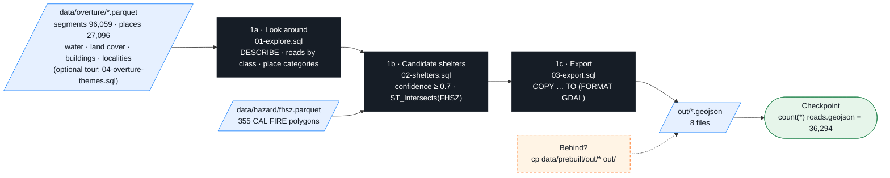

# 00-data — Phase 1: Data prep (DuckDB)

> Part of **Phase 1** in the [main README](../README.md#phase-1--data-prep--00-data). Same steps, same commands; this page adds the expected output of each one, what the SQL does, and the fixes.

Three SQL files turn the Overture + CAL FIRE extracts in `data/` into the GeoJSON that every later phase reads.
`duckdb -c "…"` runs one command and exits; `.read file.sql` runs every statement in that file. Run everything from the **repo root**.



## 1a · Look around — what is in the data before touching it

```bash
duckdb -c ".read 00-data/01-explore.sql"
```
Three plain `SELECT`s (columns / rows / count per group) over `data/overture/segments.parquet` and `places.parquet`. Expected: the `segments.parquet` schema (7 columns), drivable roads by class (sum **36,294** — the number every later step must reproduce), top-15 place categories (27,096 places).
```
┌──────────────┬───────┐
│    class     │   n   │
├──────────────┼───────┤
│ residential  │ 25995 │
│ tertiary     │  4333 │
│ secondary    │  2792 │
│ primary      │  1305 │
│ unclassified │  1265 │
│ motorway     │   541 │
│ trunk        │    63 │
└──────────────┴───────┘
```

## 1b · Candidate shelters — which places could be shelters, and do they sit in a hazard zone?

```bash
duckdb -c ".read 00-data/02-shelters.sql"
```
Four queries: `community_center` with `confidence >= 0.7` (19 rows — including a Chevrolet dealer: category data is not authoritative) →
the broader shelter-ish filter → the hand-verified `data/shelters.geojson` (10 rows, 1 verified) → which shelters sit in a **Very High** zone:
```
┌───────────────────────────────┬───────────┬──────────────────┬──────────────────┐
│             name              │  status   │       type       │ FHSZ_Description │
├───────────────────────────────┼───────────┼──────────────────┼──────────────────┤
│ Colfax High School            │ candidate │ school           │ Very High        │
│ Georgetown School             │ candidate │ school           │ Very High        │
│ Sierra Vista Community Center │ candidate │ community_center │ Very High        │
└───────────────────────────────┴───────────┴──────────────────┴──────────────────┘
```

## 1c · Export — write the eight GeoJSON files Phase 2 turns into tiles

```bash
duckdb -c ".read 00-data/03-export.sql"
ls out/
```
Eight `COPY (SELECT …) TO 'out/<name>.geojson' (FORMAT GDAL, DRIVER 'GeoJSON')` statements, each with an explicit column list (never `SELECT *` — Overture's list-typed columns would break the GeoJSON writer). Prints nothing. Expected from `ls out/`:
```
buildings_auburn.geojson  fire_perimeters.geojson  hazard.geojson  land_cover.geojson  places.geojson  roads.geojson  shelters.geojson  water.geojson
```
The roads export, typed by hand, to see the shape of one `COPY`:
```bash
duckdb -c "LOAD spatial; SET geometry_always_xy = true; COPY (SELECT id, class, subclass, name, route_ref, geometry FROM 'data/overture/segments.parquet' WHERE class IN ('motorway','trunk','primary','secondary','tertiary','residential','unclassified','living_street','motorway_link','trunk_link','primary_link','secondary_link','tertiary_link')) TO 'out/roads.geojson' (FORMAT GDAL, DRIVER 'GeoJSON')"
```

**Checkpoint** — read one exported file back and count it
```bash
duckdb -c "LOAD spatial; SELECT count(*) FROM ST_Read('out/roads.geojson')"      # → 36294
```
`LOAD spatial` turns on the geo extension; `ST_Read` opens a GeoJSON file as a table. Same 36,294 as 1a: nothing was lost on the way out.

Behind? `cp data/prebuilt/out/* out/` (PowerShell: `Copy-Item data/prebuilt/out/* out/`).

## Notes

- DuckDB 2.0 reads coordinates in the order the file's CRS says; the scripts start with `LOAD spatial; SET geometry_always_xy = true;` to force lon/lat. Points in the ocean off Africa = you forgot this.
- One `duckdb -c ".read file.sql"` per run — a dot-command after another statement in the same `-c` does not work.
- `ST_Read` needs `LOAD spatial;` in the same string (auto-load works online only).

## Optional · the other Overture themes

```bash
duckdb -c ".read 00-data/04-overture-themes.sql"
```
1a opened two of the seven files in `data/overture/`. This opens all of them — `segments`, `connectors`, `places`, `water`, `land_cover`, `localities`, `buildings_auburn` — with the Overture theme/type each came from, row counts, the clipped bbox, and one breakdown per theme (numbered routes, place confidence, water kinds, land-cover classes, towns by population, building heights). Expected output sits above every query. They were staged by [`../scripts/sql/overture.sql`](../scripts/sql/overture.sql) (`scripts/make-data.sh overture` reruns it for a new bbox in Phase 4).

## Exercises (optional)

[`exercises.md`](exercises.md): **A** primary-and-up roads · **B** nearest shelter to Foresthill (remember it for Phase 3) · **C** re-export for the Colfax box.

## Files

| File | What |
|---|---|
| `01-explore.sql` · `02-shelters.sql` · `03-export.sql` | steps 1a / 1b / 1c (`03-export.sql` is also run by `scripts/make-data.sh exports`) |
| `04-overture-themes.sql` | optional — every staged Overture theme, with expected output |
| `exercises.md` | A / B / C with collapsed solutions |
| `../scripts/sql/overture.sql` | how `data/overture/` was made — DuckDB against the Overture S3 release (Phase 4) |
