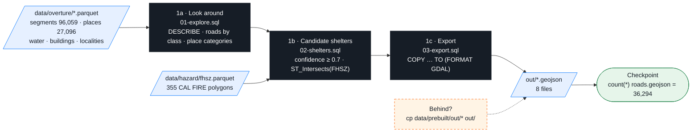

# 00-data — Phase 1: Data prep (DuckDB)

Three SQL files turn the Overture + CAL FIRE extracts in `data/` into the GeoJSON that every later phase reads.
Run everything from the **repo root**.



## 1a · Look around

```bash
duckdb -c ".read 00-data/01-explore.sql"
```
Expected: the `segments.parquet` schema (7 columns), drivable roads by class (sum **36,294**), top-15 place categories (27,096 places).
```
┌──────────────┬───────┐
│    class     │   n   │
├──────────────┼───────┤
│ residential  │ 25995 │
│ tertiary     │  4333 │
│ secondary    │  2792 │
│ primary      │  1305 │
│ unclassified │  1265 │
│ motorway     │   541 │
│ trunk        │    63 │
└──────────────┴───────┘
```

## 1b · Candidate shelters

```bash
duckdb -c ".read 00-data/02-shelters.sql"
```
Four queries: `community_center` with `confidence >= 0.7` (19 rows — including a Chevrolet dealer: category data is not authoritative) →
the broader shelter-ish filter → the hand-verified `data/shelters.geojson` (10 rows, 1 verified) → which shelters sit in a **Very High** zone:
```
┌───────────────────────────────┬───────────┬──────────────────┬──────────────────┐
│             name              │  status   │       type       │ FHSZ_Description │
├───────────────────────────────┼───────────┼──────────────────┼──────────────────┤
│ Colfax High School            │ candidate │ school           │ Very High        │
│ Georgetown School             │ candidate │ school           │ Very High        │
│ Sierra Vista Community Center │ candidate │ community_center │ Very High        │
└───────────────────────────────┴───────────┴──────────────────┴──────────────────┘
```

## 1c · Export

One export typed by hand (explicit column list, never `SELECT *`):
```bash
duckdb -c "LOAD spatial; SET geometry_always_xy = true; COPY (SELECT id, class, subclass, name, route_ref, geometry FROM 'data/overture/segments.parquet' WHERE class IN ('motorway','trunk','primary','secondary','tertiary','residential','unclassified','living_street','motorway_link','trunk_link','primary_link','secondary_link','tertiary_link')) TO 'out/roads.geojson' (FORMAT GDAL, DRIVER 'GeoJSON')"
```
Then the rest (water, shelters, hazard, fire perimeters, buildings, land cover, places):
```bash
duckdb -c ".read 00-data/03-export.sql"
ls out/
```
```
buildings_auburn.geojson  fire_perimeters.geojson  hazard.geojson  land_cover.geojson  places.geojson  roads.geojson  shelters.geojson  water.geojson
```

**Checkpoint**
```bash
duckdb -c "LOAD spatial; SELECT count(*) FROM ST_Read('out/roads.geojson')"      # → 36294
```

Behind? `cp data/prebuilt/out/* out/` (PowerShell: `Copy-Item data/prebuilt/out/* out/`).

## Notes

- DuckDB 2.0 reads coordinates in the order the file's CRS says; the scripts start with `LOAD spatial; SET geometry_always_xy = true;` to force lon/lat. Points in the ocean off Africa = you forgot this.
- One `duckdb -c ".read file.sql"` per run — a dot-command after another statement in the same `-c` does not work.
- `ST_Read` needs `LOAD spatial;` in the same string (auto-load works online only).

## Exercises (optional)

[`exercises.md`](exercises.md): **A** primary-and-up roads · **B** nearest shelter to Foresthill (remember it for Phase 3) · **C** re-export for the Colfax box.

## Files

| File | What |
|---|---|
| `01-explore.sql` · `02-shelters.sql` · `03-export.sql` | steps 1a / 1b / 1c (`03-export.sql` is also run by `scripts/make-data.sh exports`) |
| `exercises.md` | A / B / C with collapsed solutions |
| `../scripts/sql/overture.sql` | how `data/overture/` was made — DuckDB against the Overture S3 release (Phase 4) |
