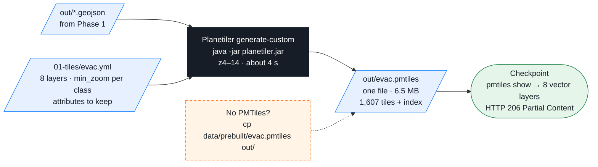

# 01-tiles — Phase 2a: Map artifacts — GeoJSON → one PMTiles file (Planetiler)

[`evac.yml`](evac.yml) is the tile schema: 8 local GeoJSON sources → 8 layers, with the zoom each class appears at and the attributes that survive into the tiles.
Run everything from the **repo root**.



## Build

```bash
java -Xmx2g -jar 01-tiles/planetiler.jar generate-custom --schema=01-tiles/evac.yml --output=out/evac.pmtiles --force
pmtiles show out/evac.pmtiles
```
Same thing with the bbox from `versions.env`, a timer and a fallback: `01-tiles/build.sh` (`--prebuilt` uses `data/prebuilt/out/`; PowerShell: `build.ps1`).

Expected:
```
tile type: mvt
bounds: (long: -121.400000, lat: 38.720000) (long: -120.520000, lat: 39.200000)
min zoom: 4
max zoom: 14
addressed tiles count: 1607
```
```bash
pmtiles show out/evac.pmtiles --metadata | grep -o '"id":"[a-z_]*"'
"id":"buildings_auburn" "id":"fire_perimeters" "id":"hazard" "id":"land_cover" "id":"places" "id":"roads" "id":"shelters" "id":"water"
```

## Serve it — the one test that matters

```bash
curl -sI -H "Range: bytes=0-15" http://localhost:8080/out/evac.pmtiles | head -1
HTTP/1.1 206 Partial Content
```
PMTiles reads byte ranges. Caddy (`docker compose up -d`) and `npx serve -l 8080 .` answer `206`; `python -m http.server` does not and the map stays blank.

## If something is red

| Message | Fix |
|---|---|
| `out/roads.geojson missing` | Phase 1 skipped → `cp data/prebuilt/out/*.geojson out/` or `01-tiles/build.sh --prebuilt` |
| `java: command not found` · `Unsupported class file major version` | Temurin 21 → [`../setup/README.md`](../setup/README.md) |
| `planetiler.jar` missing | `bash scripts/get-bundle.sh` (not in git) or `curl -L -o 01-tiles/planetiler.jar https://github.com/onthegomap/planetiler/releases/download/v0.10.2/planetiler.jar` |
| No tiles at all | `cp data/prebuilt/evac.pmtiles out/` — same file, same command |

## The schema, in short

`include_when` / `exclude_when` filter on a property (big roads from z6, local streets from z10) · `min_zoom` / `max_zoom` bound a layer (land cover stops at 12, Auburn buildings start at 13) ·
`min_size` drops features smaller than N px · `attributes` whitelist what survives into the tile. Change one number, rebuild in 4 s, reload the map.

Exercises: raise the local-street `min_zoom` from 10 to 12 and compare `ls -la out/evac.pmtiles` · add `subclass` to roads and dash `motorway_link` ramps in 02-web · add a `rivers` layer from `out/water.geojson` with `include_when: { subtype: river }`.

| File | What |
|---|---|
| [`evac.yml`](evac.yml) | the schema |
| [`build.sh`](build.sh) / [`build.ps1`](build.ps1) | the one-line build + `--bounds`, timer, `--prebuilt` fallback |
| `planetiler.jar` | Planetiler v0.10.2 (89 MB, from `scripts/get-bundle.sh`) |
