# 02-web — Phase 3a/3b: Application — style the map, three views

> Part of **Phase 3** (steps 3a and 3b) in the [main README](../README.md#phase-3--application--02-web--03-routing--demo). Same clicks; this page adds what each step file contains, how the page works and the fixes. Step 3c (routing) is [`../03-routing/`](../03-routing/) — it plugs into this page, which is why this folder comes first.

`index.html` is one MapLibre GL JS page (6.14, ESM) + pmtiles.js. It starts empty.
The **Edit** button (top-left) opens a panel with one row per dataset; **Add** plugs the file into the live map (no file edits, no reload). Row 0 is the tiles (`../out/evac.pmtiles`, falls back to `../data/prebuilt/evac.pmtiles`); rows 1–4 are JSON arrays of MapLibre layers in [`steps/`](steps/) and stay locked until the tiles are in.

```mermaid
flowchart LR
  classDef file fill:#E6F0FF,stroke:#0678FF,color:#161D26
  classDef tool fill:#161D26,stroke:#161D26,color:#FFFFFF
  classDef step fill:#FFFFFF,stroke:#8A939B,color:#161D26
  classDef chk  fill:#E6F5EA,stroke:#2E8B57,color:#161D26
  classDef bail fill:#FFF4E5,stroke:#FF6101,color:#161D26,stroke-dasharray:5 4

  PM[/"out/evac.pmtiles"/]:::file
  SV["Serve on :8080<br/>Caddy or npx serve<br/>must answer 206"]:::tool
  S0["Add 0 · tiles<br/>out/evac.pmtiles"]:::step
  S1["Add 1 · roads<br/>step1-roads.json"]:::step
  S2["Add 2 · hazard · water<br/>land cover · shelters · labels<br/>step2-hazard-water.json"]:::step
  S3["Add 3 · fire perimeters<br/>step3-styled.json<br/>(also the bail-out: has 1 + 2)"]:::step
  S4["Add 4 · 3D buildings<br/>step4-final.json<br/>zoom ≥ 13 over Auburn"]:::step
  V(["Three views, one at a time<br/>Fire evac map · Base map · Shelter reach"]):::chk
  CB[/"data/coverage/coverage_bands.geojson<br/>scripts/make-coverage.py"/]:::file
  B["Blank map?<br/>python -m http.server ignores Range<br/>Lost? open solution.html"]:::bail

  PM --> SV --> S0 --> S1 --> S2 --> S3 --> S4 --> V
  CB --> V
  B -.-> SV
```



## Open it

| How you run | URL |
|---|---|
| Codespaces | **Ports** tab → row **8080** → globe icon → add `/02-web/` |
| Docker / Finch (`docker compose up -d`) | <http://localhost:8080/02-web/> |
| Native (`npx serve -l 8080 .` from the repo root) | <http://localhost:8080/02-web/> |
| Browser only | <https://vishal4c.github.io/routes-to-safety-workshop/02-web/> |

Never `python -m http.server`: PMTiles needs `Range` requests (`206`), it answers `200` and the map stays blank.

## Steps — Fire evac map → Edit → Add

0. **Tiles** (`out/evac.pmtiles`, built in Phase 2a) → a dashed box around the covered area, the row lists the file's 8 layers and tile count, rows 1–4 unlock. A "Using the prebuilt tiles" note = `out/evac.pmtiles` was not found. Rebuilt the tiles? **Reload** this row; added layers redraw on the new file.
1. **Roads** (`steps/step1-roads.json`) → grey roads (motorways darker).
2. **Hazard, water, land cover, shelters, labels** (`steps/step2-hazard-water.json`) → `match` on `FHSZ_Description` (Moderate `#fdbb84` · High `#e34a33` · Very High `#b30000`), blue water, green land cover, 10 shelter circles (filled = verified), town labels (fonts in `fonts/`, works offline).
3. **Fire perimeters** (`steps/step3-styled.json`) → dashed grey River 2021 / Mosquito 2022. Contains steps 1 + 2 as well.
4. **3D buildings** (`steps/step4-final.json`) → zoom to Auburn (≥ 13), tilt with right-drag or the compass. Click a shelter for its popup.

Restyle: edit the JSON file, click the row's **Reload** — the layers are replaced in place. Layer order is automatic (water < land cover < hazard < perimeters < reach rings < roads < buildings < route < shelters < labels); a layer id that appears in two files is taken from the file added last. Everything plugged in stays until the page is refreshed. Shortcut: `index.html?steps=1,2,3,4&reach=1&routing=1` (steps imply the tiles).

Checkpoint: Very High solid dark red · water blue · 10 shelter circles, 1 filled (Sierra College) · Mosquito perimeter dashed · attribution visible.
Lost? open `02-web/solution.html` — `index.html` with everything preloaded.

## Three views, one at a time (buttons top-left) — Phase 3b

| View | Shows | Needs |
|---|---|---|
| **Fire evac map** (default) | our tiles: hazard, land cover, water, roads, buildings, places, fire perimeters, shelters | nothing — offline |
| **Base map** | OpenStreetMap raster; only shelters, the pin and the route on top | internet (`tile.openstreetmap.org`) |
| **Shelter reach** | drive-time bands from every shelter: ≤ 10 min green · ≤ 20 blue · ≤ 30 light red; click a shelter to isolate it | Edit → Add tiles + roads/shelters (if not yet), then the rings: `data/coverage/coverage_bands.geojson` |

The switch only toggles `visibility` over a list of layer ids (`VIEW_LAYERS`); the legend follows the view. Nothing is overlaid: hazard is never drawn under the reach bands. Routing (Phase 3c) works in every view.

Reach bands come from Phase 2c (H3 res-8 cells → OSRM `/table` → minutes to each shelter → dissolved per shelter and band):
```bash
scripts/make-coverage.py --osrm http://osrm:5000       # in the tool container; laptop: --osrm http://localhost:8080/osrm
```

## Inspect your tiles

`pmtiles show out/evac.pmtiles` → 8 layers, z4–14. In the browser console: `map.queryRenderedFeatures()[0].properties` · `window.setView('reach')` · `window.setReachShelter('placer-high')`.

## Files

| File | What |
|---|---|
| `index.html` | the page you edit |
| `steps/*.json` | plain JSON arrays of MapLibre layer objects, one per step |
| `solution.html` | bail-out; regenerate with `python3 scripts/make-solution.py` after editing `index.html` or step 4 |
| `style.json` | the finished style as a standalone MapLibre style (Maputnik, demo): `pmtiles serve out --port 8077 --cors="*"` then *Open → Load from URL* `http://localhost:8080/02-web/style.json` |
| `fonts/` | Noto Sans glyphs (OFL) for the labels |
| routing (Phase 3c) | Edit → **Routing** row (loads `../03-routing/route.js`); or build it yourself via the commented `import('../03-routing/…')` lines at the end of `index.html` → [`../03-routing/`](../03-routing/) |
