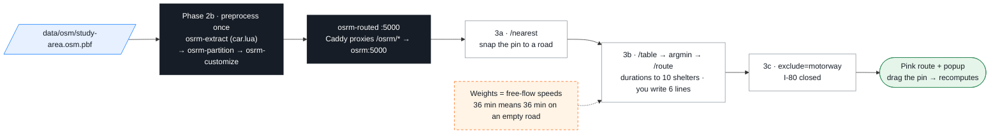

# 03-routing — Phase 3c: Application — nearest shelter by road (OSRM)

OSRM turns the road graph (Phase 2b artifact: `data/osrm/study-area.osrm.*`, 99 MB, served by the `osrm` container, proxied by Caddy at `/osrm`) into three HTTP calls.
One JavaScript module, [`route.js`](route.js), does the rest — in every view of the map.



## Where OSRM is

| How you run | `$OSRM_URL` for `curl` | In the page |
|---|---|---|
| Codespaces | `<forwarded-8080-URL>/osrm` (Ports tab → 8080; never forward 5000) | same-origin `/osrm` |
| Docker / Finch — laptop shell | `http://localhost:8080/osrm` | same-origin `/osrm` |
| Docker / Finch — inside `docker compose exec workshop bash` | `$OSRM_URL` is preset to `http://caddy:8080/osrm` | — |
| Native / browser only | none — OSRM ships no Windows/macOS binary | page says *Routing needs OSRM — map and shelters still work*; the Pages site uses `router.project-osrm.org` (no `exclude=motorway`) |

## The three calls (HTTP API v1, profile `driving`)

| Call | Answers |
|---|---|
| `GET $OSRM_URL/nearest/v1/driving/{lon},{lat}` | which road point is closest to the pin (`"code":"Ok"`, `waypoints`) |
| `GET $OSRM_URL/table/v1/driving/{pin};{s1};…;{s10}?sources=0&annotations=duration,distance` | `durations[0][i]` seconds, `distances[0][i]` metres, pin → each shelter |
| `GET $OSRM_URL/route/v1/driving/{pin};{winner}?overview=full&geometries=geojson[&exclude=motorway]` | `routes[0].geometry`, `.duration` (s), `.distance` (m) |

## Steps

**3a · Hello route**
```bash
curl "$OSRM_URL/nearest/v1/driving/-121.08,38.90"          # PowerShell: curl.exe
{"code":"Ok","waypoints":[{"location":[-121.08…,38.90…], …}]}
```
In `02-web/index.html` uncomment `import('../03-routing/steps/step1-route.js')` → reload → pink line Foresthill → Placer High School; console: `Route: 35.8 min, 31.8 km`.
No line? Console (F12): a red `/osrm 404` means your :8080 server is not Caddy — use the URL from the table above.

**3b · Nearest shelter by road** — switch the import to `steps/step2-scaffold.js`; in it, fill the block `YOU WRITE THESE 6 LINES`:
1. `/table` with `sources=0&annotations=duration,distance` (pin first, then the 10 shelters)
2. `secs = durations[0]` without its first entry (pin → pin)
3. `best = argmin(secs)`
4. `/route` to the best shelter, `overview=full&geometries=geojson`
5. `setRoute(route.geometry)`
6. `showPopup(…, "Name · ~N min drive (free-flow, no traffic) · K km")`

Expected (start = Foresthill): **Placer High School · ~36 min · 31.8 km**. Nearest on the map is Georgetown School (12.4 km) — by road it is 59.7 min / 54 km.
Drag the pin anywhere in the box: the route recomputes. Stuck? point the import at `steps/step3-solution.js`.

**3c · "I-80 is closed"** — add `&exclude=motorway` to both URLs (the finished version is the checkbox top-right).
From **Dutch Flat (-120.838, 39.198)** to Sierra Vista Community Center: 17.9 min → **31.3 min**, via Dutch Flat Rd / Magra Rd / Rollins Lake Rd.
A real closure is not a URL parameter — this shows the calculation, not detection.

## Build the graph yourself — Phase 2b (optional, on the laptop — needs Docker/Finch)

```bash
scripts/build-osrm.sh data/osm/colfax.osm.pbf out/osrm        # tiny clip, about a minute
scripts/build-osrm.sh                                          # the full study area → data/osrm/  (then: docker compose restart osrm)
```
Runs `osrm-extract` (car profile) → `osrm-partition` → `osrm-customize` in `ghcr.io/project-osrm/osrm-backend:v26.10.0-debian`.

## Files

| File | What |
|---|---|
| `steps/step1-route.js` | 3a — one hard-coded route |
| `steps/step2-scaffold.js` | 3b — you write 6 lines |
| `steps/step3-solution.js` = `route.js` | 3b + 3c finished (I-80 checkbox) |
| `grid.sql` · `exercises.md` | stretch: 400 grid points → one `/table` POST → reach colouring |

Each module exports `start(map, maplibregl)`; `02-web/index.html` has the commented `import(...)` lines.
