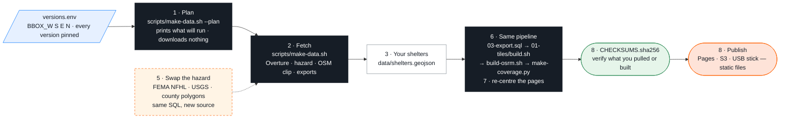

# 04-adapt — Phase 4: Adapt the pipeline to your own community

> Part of **Phase 4** in the [main README](../README.md#phase-4--adapt-the-pipeline-to-your-community--04-adapt). Same eight steps; this page adds the expected output, the hazard-swap table and what changes at scale.

Every script reads one file, [`versions.env`](../versions.env). Change the bounding box, re-run the same pipeline, get the same map for a different place.
Run everything from the **repo root**.



## Steps

1. **Box** — draw one around your community ([bboxfinder.com](http://bboxfinder.com)), keep it under ~0.5 sq. degrees, put W,S,E,N into the four `BBOX_*` lines (no spaces around `=`). Pick the matching Geofabrik region in `OSM_EXTRACT_URL`.
2. **Plan** — no network, nothing written:
   ```bash
   scripts/make-data.sh --plan
   ```
   Expected (default box): `Study area bbox: -121.40,38.72,-120.52,39.20  (0.422 sq. degrees)`, then the Overture queries and output files with size estimates (`segments.parquet ~17.7 MB …`). Edit the box, run again, watch the estimates change.
   Misbehaves? `git checkout versions.env` restores the default.
3. **Fetch** — network; the Geofabrik extract is the big download:
   ```bash
   scripts/make-data.sh                     # overture · hazard · osm · exports   (one stage: scripts/make-data.sh overture)
   ```
4. **Shelters** — replace `data/shelters.geojson` (`id, name, status, type, town, source`); everything is `candidate` until a primary source confirms it. Set `AUBURN_*` to the town whose buildings you want in 3D.
5. **Hazard outside California** — swap the source, keep the SQL and the style → [Swap the hazard](#swap-the-hazard) below.
6. **Rebuild the artifacts**
   ```bash
   duckdb -c ".read 00-data/03-export.sql"            # out/*.geojson
   01-tiles/build.sh                                  # out/evac.pmtiles
   scripts/build-osrm.sh                              # data/osrm/  — option B: laptop terminal (needs Docker/Finch) · Codespaces: its terminal; then: docker compose restart osrm
   scripts/make-coverage.py --osrm http://osrm:5000   # data/coverage/*.geojson   (laptop: --osrm http://localhost:8080/osrm)
   ```
7. **Re-centre the pages** — `center` / `zoom` in `02-web/index.html` and `demo/app.js`, the default pin (`START`) in `03-routing/route.js`. Your rebuilt files land on the default paths, so the Edit panel in `02-web/` needs no change; files elsewhere: type their path into the row's text box.
8. **Verify and publish** — `sha256sum -c data/CHECKSUMS.sha256`; regenerate your own list with `scripts/make-bundle.sh`; push `out/evac.pmtiles`, `data/coverage/`, `02-web/`, `demo/` to any static host that answers Range requests. Keep the attribution line and the disclaimer on the map.

## Swap the hazard

The hazard layer is one polygon file with a class column. Replace it, keep the style.

| Hazard | Source | Query |
|---|---|---|
| **Flood** — FEMA National Flood Hazard Layer (US Government work, public domain) | `https://hazards.fema.gov/arcgis/rest/services/public/NFHL/MapServer` (flood-hazard-zones sub-layer; layer 28 in `NFHL_Print/NFHLQuery/MapServer`) | same pattern as `scripts/fetch_arcgis.py`: `…/query?where=1=1&geometry=W,S,E,N&geometryType=esriGeometryEnvelope&inSR=4326&outFields=*&f=geojson` — then style by the flood-zone field (check the layer's field list; `A`/`AE` are the mapped high-risk zones). Untested in the workshop build |
| **Wildfire, live** — CAL FIRE active incidents | `https://incidents.fire.ca.gov/umbraco/Api/IncidentApi/GeoJsonList` (undocumented, no SLA; page it backs: <https://www.fire.ca.gov/incidents>) | points with `Name`, `AcresBurned`, `PercentContained`, `IsActive` |
| **Evacuation zones, live** — Cal OES aggregation | `https://services.arcgis.com/BLN4oKB0N1YSgvY8/arcgis/rest/services/CA_EVACUATIONS_CalOESHosted_view/FeatureServer/0` | only publishes zones with an active order/warning; empty most days |
| **Wildfire, static** — CAL FIRE FHSZ (what we use) | `CALFIRE_FHSZ_URL` in `versions.env` | `scripts/make-data.sh hazard` |

> ⚠️ **Going live raises the stakes on every caveat in the disclaimer.** A static hazard layer that is out of date is embarrassing; a live
> perimeter that is out of date, or a "safe" route through a road nobody has mapped as closed, can hurt someone. Before you
> wire a live feed into anything people will use: show the feed's own timestamp on the map, say what the data does *not*
> contain (shelter status, closures, capacity, drive time ≠ evacuation time), and send people to the official sources.

> Teaching example, not an official evacuation resource. Drive-time estimates assume no traffic and no closures. In an emergency follow county OES / Genasys-Zonehaven alerts and CAL FIRE incident pages.

## Laptop → planet

| What we did on a laptop | What changes at scale |
|---|---|
| DuckDB reads Overture over S3 with bbox pushdown | Same query, bigger box. For a state/country, filter by `theme`/`type` and write one parquet per region; use `bbox` columns, not `ST_Intersects`, to prune. Overture also ships a CLI (`overturemaps download`). |
| Planetiler `generate-custom` from GeoJSON, 4 s | Planetiler's built-in profiles read OSM PBF directly and can build a planet on one large machine (see the Planetiler docs for current times and RAM); `--bounds` limits it to a region. Output is the same PMTiles. |
| PMTiles on any static host (Range requests) | S3 + CloudFront / Cloudflare R2. No tile server. |
| OSRM MLD graph for 0.4 sq. degrees, 99 MB, 15 s | Large graphs need far more RAM and disk to build (see the OSRM wiki); use regional Geofabrik extracts, or Valhalla / GraphHopper / OpenRouteService if you need isochrones, traffic profiles or alternatives. |
| `/table` 10 shelters × ~3,300 hexes | `--max-table-size` grows memory quadratically; batch the requests (as `scripts/make-coverage.py` does). |

