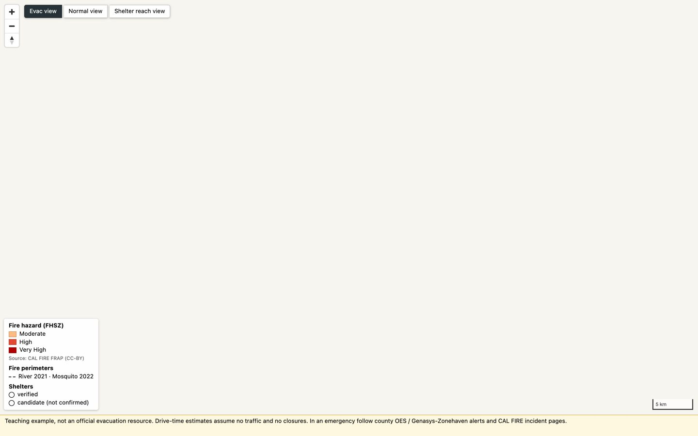
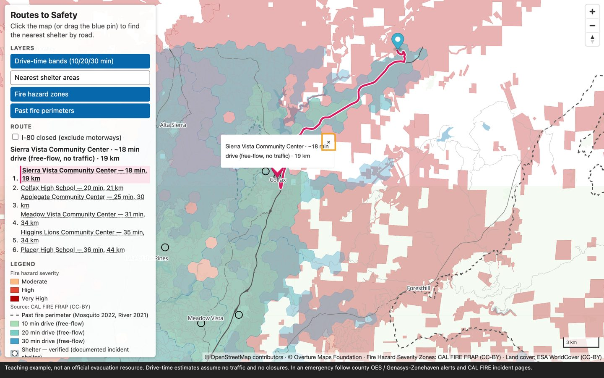
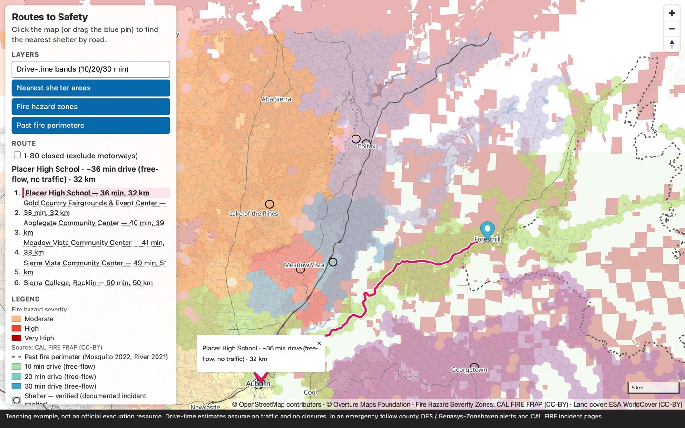

# Routes to Safety — a wildfire-evacuation map from open data

Hands-on workshop for **FOSS4G North America 2026** · Sacramento, CA · Mon Nov 2, 2026, 09:00–12:00 · room Beavis.
Welcome! In three hours you build a wildfire-evacuation map for a real place — the **Placer County I-80 corridor** — with open
data and open tools, then compute over it: *which shelter can I reach by road, and how long does it take if I-80 is closed?*

**Finished result:** <https://vishal4c.github.io/routes-to-safety-workshop/demo/>


> **Teaching example, not an official evacuation resource.** Drive-time estimates assume no traffic and no closures.
> In an emergency follow county OES / Genasys-Zonehaven alerts and CAL FIRE incident pages.

## Goal

1. **Query** Overture Maps and CAL FIRE hazard data with [DuckDB](https://duckdb.org/docs/extensions/spatial) — no database server.
2. **Generate** the artifacts: one [PMTiles](https://docs.protomaps.com/pmtiles/) file with [Planetiler](https://github.com/onthegomap/planetiler), and an [OSRM](https://project-osrm.org/) routing graph.
3. **Style** the tiles in [MapLibre GL JS](https://maplibre.org/) and precompute shelter reach.
4. **Run** the application: nearest shelter by road, "I-80 is closed", three map views.
5. **Repeat it for your own community** by changing one line.

Every phase below has the exact command, what you should see, and a screenshot. Always run commands from the **repo root**.

## Setting up the development environment

Pick **one** of the three options. Options A and B give you everything, including routing. Everything is pinned in [`versions.env`](versions.env).

### Option A — GitHub Codespaces (nothing to install)

[](https://codespaces.new/vishal4c/routes-to-safety-workshop?quickstart=1)

Or: on the [repository page](https://github.com/vishal4c/routes-to-safety-workshop) click the green **Code** button → **Codespaces** tab → **Create codespace on main**.
You need a **personal** GitHub account (free tier is enough). The devcontainer starts three containers — the tool shell, OSRM and Caddy — and
downloads the 150 MB data bundle; after a minute you are dropped into a terminal with `setup/check_setup.py` already run.

Open the map from the **Ports** tab → port **8080** → globe icon. Never forward port 5000; routing is reached through `/osrm` on port 8080.

### Option B — the Docker image on your laptop (if Codespaces is blocked or the wifi is bad)

The same tool image Codespaces uses is published for amd64 and arm64:
**`ghcr.io/vishal4c/routes-to-safety-workshop:latest`** — DuckDB 2.0.0 + spatial, Temurin 21, Planetiler 0.10.2, go-pmtiles 1.31.2,
Node 22, osmium-tool, uv, Python 3. Nothing to install except a container runtime
([Docker Desktop](https://www.docker.com/products/docker-desktop/), [Finch](https://runfinch.com/) — `finch vm init` once — , OrbStack, Colima or Podman;
replace `docker` with `finch`/`podman` below).

```bash
git clone --depth 1 https://github.com/vishal4c/routes-to-safety-workshop.git
cd routes-to-safety-workshop
docker compose pull            # 3 images: the tool image, OSRM, Caddy  (≈ 1 GB, once)
docker compose up -d           # starts  workshop · osrm · caddy
docker compose exec workshop bash
```

You are now in the tool container, in `/workspaces/routes-to-safety-workshop`, which **is** the folder you cloned (bind-mounted):
files you write in the container appear on your laptop and are served by Caddy at <http://localhost:8080/> straight away.
First time only, fetch the data bundle (prebuilt tiles, routing graph, OSM extracts; 150 MB, checksum-verified) and check the setup:

```bash
bash scripts/get-bundle.sh
python3 setup/check_setup.py
```


| What | Where |
|---|---|
| Map and lab pages | <http://localhost:8080/02-web/> on your laptop (Caddy serves the repo; it answers Range requests, which PMTiles needs) |
| OSRM | from the browser: same-origin `/osrm/…` · from the container shell: `$OSRM_URL` = `http://caddy:8080/osrm` (also `http://osrm:5000`) |
| Stop / restart | `docker compose down` · `docker compose up -d` (data stays in your folder) |
| Offline room | `BUNDLE_ZIP=/path/data-bundle.zip bash scripts/get-bundle.sh` installs from a USB copy |

The only thing the tool container cannot do is *build* a new OSRM graph (it has no Docker inside). You do not need that for the
workshop — the graph ships in the bundle — and for your own town you run `scripts/build-osrm.sh` **on the laptop** (Phase 5).

### Option C — native tools, no containers

Install Git, DuckDB CLI 2.0.0, Temurin 21, Node 22, uv and go-pmtiles, then `bash scripts/get-bundle.sh` and serve the repo with
`npx serve -l 8080 .` (**never** `python -m http.server`: it ignores Range requests and the map stays blank). Everything works except
routing — OSRM ships no native Windows/macOS binary — so pair with a neighbour for Phase 4. Per-OS commands: [`setup/README.md`](setup/).

### Lab 0 — the one-line checkpoint (every option)

```bash
duckdb -c ".read setup/hello-geo.sql"
```
```
OK — DuckDB 2.0.0 · 10 shelters (1 verified, 9 candidate) · nearest to Colfax (crow-flies): Sierra Vista Community Center, 0.2 km
```
Same line on every screen → you are ready. Red for more than 10 minutes → switch option, or follow along on the demo site.

---

## Phase 1 — Querying the datasets (DuckDB) · [`00-data/`](00-data/)

The study-area extracts are already in `data/overture/*.parquet` (Overture Maps release 2026-09-23.1: 96,059 road segments, 27,096 places,
water, buildings, localities) and `data/hazard/` (CAL FIRE Fire Hazard Severity Zones, fire perimeters). Three SQL files, three steps.

### 1a · Look around

```bash
duckdb -c ".read 00-data/01-explore.sql"
```

**Expected:** three tables — the schema of `segments.parquet`, drivable roads by class (sum **36,294**), and the top-15 place categories.

```
┌──────────────┬───────┐
│    class     │   n   │
├──────────────┼───────┤
│ residential  │ 25995 │
│ tertiary     │  4333 │
│ secondary    │  2792 │
│ primary      │  1305 │
│ unclassified │  1265 │
│ motorway     │   541 │
│ trunk        │    63 │
└──────────────┴───────┘
```

### 1b · Candidate shelters, tagged with the hazard class

```bash
duckdb -c ".read 00-data/02-shelters.sql"
```

**Expected:** 10 shelters (community centres, schools, a fairground — `confidence ≥ 0.7`), then `ST_Intersects` against the FHSZ polygons:

```
┌───────────────────────────────┬───────────┬──────────────────┬──────────────────┐
│             name              │  status   │       type       │ FHSZ_Description │
├───────────────────────────────┼───────────┼──────────────────┼──────────────────┤
│ Colfax High School            │ candidate │ school           │ Very High        │
│ Georgetown School             │ candidate │ school           │ Very High        │
│ Sierra Vista Community Center │ candidate │ community_center │ Very High        │
└───────────────────────────────┴───────────┴──────────────────┴──────────────────┘
```
Three of the ten candidate shelters sit inside a *Very High* hazard zone — the map will show that.

### 1c · Export everything to GeoJSON

```bash
duckdb -c ".read 00-data/03-export.sql"
ls -la out/
```

**Expected:** 8 files in about 10 s — `roads` (17 MB), `hazard` (11 MB), `buildings_auburn`, `land_cover`, `water`, `fire_perimeters`, `places`, `shelters`.
Checkpoint:

```bash
duckdb -c "LOAD spatial; SELECT count(*) FROM ST_Read('out/roads.geojson')"      # → 36294
```

> DuckDB 2.0 note: the scripts start with `LOAD spatial; SET geometry_always_xy = true;` so coordinates are lon/lat everywhere.
> Behind? `cp data/prebuilt/out/* out/` gives you the same files. Exercises: [`00-data/exercises.md`](00-data/exercises.md).

---

## Phase 2 — Generating the map artifacts for visualisation and routing · [`01-tiles/`](01-tiles/) · [`03-routing/`](03-routing/)

Two artifacts come out of this phase: **one tile file** for the browser and **one routing graph** for OSRM.

### 2a · Tiles: GeoJSON → `evac.pmtiles` with Planetiler

[`01-tiles/evac.yml`](01-tiles/evac.yml) is the schema: 8 layers, which attributes to keep, which zoom each road class appears at.

```bash
01-tiles/build.sh            # = java -Xmx2g -jar 01-tiles/planetiler.jar generate-custom --schema=01-tiles/evac.yml --output=out/evac.pmtiles …
pmtiles show out/evac.pmtiles
```

**Expected:**
```
0:00:04 INF [archive] - 	archive	6.5MB
[20:38:12] built out/evac.pmtiles in 4s
pmtiles spec version: 3
tile type: mvt
bounds: (long: -121.400000, lat: 38.720000) (long: -120.520000, lat: 39.200000)
min zoom: 4
max zoom: 14
addressed tiles count: 1607
vector_layers <object, use --metadata to view full JSON metadata>
```

One file, 6.5 MB, every tile from z4 to z14 with an index. The browser asks for byte ranges, so any static host works — no tile server.
The one test that matters for your web server:

```bash
curl -sI -H "Range: bytes=0-15" http://localhost:8080/out/evac.pmtiles | head -1     # in the container: http://caddy:8080/…
HTTP/1.1 206 Partial Content
```

### 2b · Routing graph: OSM → OSRM (MLD)

The graph for the study area is in the bundle (`data/osrm/study-area.osrm.*`, 99 MB) and already loaded by the `osrm` container.
It was built with three OSRM commands — extract (car profile), partition, customize — which [`scripts/build-osrm.sh`](scripts/build-osrm.sh)
runs inside the pinned OSRM image. To see them run on a tiny clip (about a minute, **on the laptop**, needs Docker/Finch):

```bash
scripts/build-osrm.sh data/osm/colfax.osm.pbf out/osrm
```

Check the engine answers:

```bash
curl "$OSRM_URL/nearest/v1/driving/-121.08,38.90"          # laptop: OSRM_URL=http://localhost:8080/osrm
{"code":"Ok","waypoints":[{"location":[-121.08…,38.90…],"name":"…"}]}
```

---

## Phase 3 — Styling and prepping the data for the application · [`02-web/`](02-web/)

[`02-web/index.html`](02-web/index.html) is a MapLibre page with four empty paste points, `STEP1 … STEP4`. Each step is a JSON array of layers
in [`02-web/steps/`](02-web/steps/). Open <http://localhost:8080/02-web/> and reload after each paste.

| Before you paste anything | **Step 1** — roads (`steps/step1-roads.json`) |
|---|---|
|  |  |
| A blank-but-alive map: the three view buttons and the legend are HTML; the tiles are not drawn yet. | One `line` layer per road group; `line-width` grows with zoom. Also uncomment the `AttributionControl` lines — the data licences require it. |

| **Step 2** — hazard, water, land cover, shelters, town labels (`step2-hazard-water.json`) | **Step 3** — fire perimeters, everything so far in order (`step3-styled.json`) |
|---|---|
|  |  |
| A `match` expression colours `FHSZ_Description` Moderate / High / Very High; shelters are a `circle` layer, filled when `status = verified`; a `symbol` layer names the towns (fonts vendored in `02-web/fonts/`). Click a shelter for its popup. | River 2021 and Mosquito 2022 perimeters as dashed `line` layers. This file also contains steps 1 + 2 — the page de-duplicates by layer id and sorts into draw order, so it doubles as the bail-out. |

| **Step 4** — 3D buildings (`step4-final.json`, zoom ≥ 13 over Auburn) | **Three views, one at a time** |
|---|---|
|  |  |
| `fill-extrusion` from Overture building heights, only at zoom ≥ 13 over Auburn — pitch the map (right-drag or the compass) to see it. | **Evac** (our tiles, works offline) · **Normal** (OSM raster underneath) · **Shelter reach** (next step). The switch toggles layer visibility — one style, no reload. |

Behind at any point? `02-web/solution.html` is `index.html` with step 4 pasted and the routing module imported.

### Prepping the reach data

The **Shelter reach** view needs one more artifact: drive-time bands around every shelter. [`scripts/make-coverage.py`](scripts/make-coverage.py)
lays an H3 grid (res 8, ~0.7 km² cells) over the bbox, asks OSRM `/table` for the drive time from every road-bearing cell to all 10 shelters
(batched, 3,341 cells) and dissolves the result with DuckDB spatial into nested 10 / 20 / 30-minute bands.

```bash
scripts/make-coverage.py --osrm http://osrm:5000        # in the container; on the laptop: --osrm http://localhost:8080/osrm
```
```
3341 road-bearing hex cells at res 8; 10 shelters
  batch 1: 500 cells … batch 7: 341 cells
  coverage_hex.geojson: 1.4 MB
  coverage_bands.geojson: 0.1 MB
done in 30s
```


≤ 10 min green · ≤ 20 min blue · ≤ 30 min light red. Click a shelter to see only its own bands. The bands are **drive time on an empty road** —
the view never draws them on top of the hazard fill, so nobody reads "reachable" as "safe".

---

## Phase 4 — Setting up and running the application · [`03-routing/`](03-routing/)

The application is the styled page plus one JavaScript module, [`03-routing/route.js`](03-routing/route.js), that talks to OSRM.
Three HTTP calls do all the work:

| Call | Question it answers |
|---|---|
| `GET /nearest/v1/driving/{lon},{lat}` | which road point is closest to the pin? |
| `GET /table/v1/driving/{pin};{10 shelters}?sources=0` | how many seconds from the pin to **each** shelter? |
| `GET /route/v1/driving/{pin};{winner}?geometries=geojson` | the line to draw, with duration and distance |

### 4a · Hello route

In `02-web/index.html` uncomment `import('../03-routing/steps/step1-route.js')` → reload. A pink line runs from Foresthill to Placer High School
and the console prints `Route: 35.8 min, 31.8 km`.

### 4b · Nearest shelter by road — you write six lines

Switch the import to `steps/step2-scaffold.js` and fill in the block marked `YOU WRITE THESE 6 LINES`: call `/table`, drop the first
duration (pin → pin), take the argmin, call `/route` to the winner, draw it, show the popup. Stuck? `steps/step3-solution.js` is the answer.


**Nearest on the map ≠ nearest by road.** From Foresthill the closest shelter as the crow flies is Georgetown School, 12.4 km away.
By road it is 59.7 min / 54 km (American River canyon); Placer High is 35.8 min. Drag the pin anywhere in the box — the route recomputes.

### 4c · "I-80 is closed"

Tick the **I-80 closed** checkbox: both calls get `&exclude=motorway`. From Dutch Flat the nearest shelter stays Sierra Vista Community Center,
but 17.9 min becomes **31.3 min** via Dutch Flat Rd / Magra Rd / Rollins Lake Rd.

| I-80 open | I-80 closed |
|---|---|
|  |  |

> A real closure is not a URL parameter. This shows the calculation, not detection; shelter status, traffic, smoke and capacity are not in the data.

### The finished application

[`demo/`](demo/) is the same map with a sidebar: a ranked list of shelters, the hex view of "which shelter is nearest from here", and
the three toggles. It runs from static files on GitHub Pages and talks to OSRM (your Caddy proxy locally, the public OSRM server on the Pages site).

| <http://localhost:8080/demo/> | Nearest-shelter areas (`coverage_hex.geojson`) |
|---|---|
|  |  |

Deploy it anywhere that serves static files with Range requests: GitHub Pages, S3 + CloudFront, a USB stick.

---

## Phase 5 — Running the pipeline for your own locality · [`04-adapt/`](04-adapt/)

Everything above reads one file, [`versions.env`](versions.env). Recommended order:

1. **Draw a box** around your community ([bboxfinder.com](http://bboxfinder.com)); keep it under about 0.5 sq. degrees for a laptop. Put it in the four
   `BBOX_*` lines of `versions.env` (no spaces around `=`).
2. **Plan first** — prints every query, file and size estimate, downloads nothing:
   ```bash
   scripts/make-data.sh --plan
   ```
3. **Fetch** (network; the Geofabrik OSM extract is the big one — pick the right region in `OSM_EXTRACT_URL`):
   ```bash
   scripts/make-data.sh                     # overture · hazard · osm · exports  (or one stage: scripts/make-data.sh overture)
   ```
4. **Shelters** — replace `data/shelters.geojson` with your own (`id, name, status, type, town, source`); mark everything `candidate` until a primary
   source confirms it. Adjust `AUBURN_*` to the town whose buildings you want in 3D.
5. **Hazard** — the FHSZ layer exists only for California. Swap the source, keep the SQL and the style: FEMA NFHL flood zones, USGS, county polygons —
   see the table in [`04-adapt/README.md`](04-adapt/README.md#swap-the-hazard). Going *live* (active incidents, evacuation zones) raises the stakes; read the caveats there first.
6. **Rebuild the artifacts**
   ```bash
   duckdb -c ".read 00-data/03-export.sql"          # out/*.geojson for the new box
   01-tiles/build.sh                                # out/evac.pmtiles
   scripts/build-osrm.sh                            # data/osrm/study-area.osrm.*  — on the laptop (needs Docker/Finch), then: docker compose restart osrm
   scripts/make-coverage.py --osrm http://osrm:5000 # data/coverage/*.geojson
   ```
7. **Point the pages at the new place**: `center`/`zoom` in `02-web/index.html` and `demo/`, the default pin in `03-routing/route.js`.
8. **Verify and publish**: `sha256sum -c data/CHECKSUMS.sha256` for what you downloaded; regenerate your own list with `scripts/make-bundle.sh`;
   push `out/evac.pmtiles`, `data/coverage/`, `02-web/` and `demo/` to any static host. Keep the attribution line and the disclaimer on the map.

Laptop → planet: the same shapes scale (Planetiler builds a planet on one large machine; OSRM graphs for a state need RAM; PMTiles on S3 needs no server) —
the table in [`04-adapt/README.md`](04-adapt/README.md#laptop--planet) says what changes.

---

## Workshop agenda (3 hours)

| Time | Block | Folder | You do |
|---|---|---|---|
| 0:00–0:30 | 1 Setup & the problem | [`setup/`](setup/) | Lab 0 · River Fire 2021, Mosquito Fire 2022, the two questions |
| 0:30–1:10 | 2 Extract the data | [`00-data/`](00-data/) | Phase 1 (labs 1a–1c) |
| 1:10–1:20 | Break | | |
| 1:20–2:05 | 3 Build the basemap | [`01-tiles/`](01-tiles/) · [`02-web/`](02-web/) | Phase 2a + Phase 3 (labs 2a–2c) |
| 2:05–2:37 | 4 Compute the routes | [`03-routing/`](03-routing/) | Phase 4 (labs 3a–3c) |
| 2:37–3:00 | 5 Reproduce, adapt, scale | [`04-adapt/`](04-adapt/) | Phase 5 (lab 4) · recap |

Slides: [`slides/`](slides/). Instructor material (prep checklist, wifi-death runbook): [`instructor/`](instructor/).

## The stack (pinned in [`versions.env`](versions.env))

| Tool | Version | | Tool | Version |
|---|---|---|---|---|
| DuckDB CLI + spatial | 2.0.0 | | MapLibre GL JS | 6.14.0 |
| Temurin / OpenJDK | 21 | | PMTiles (JS) | 4.5.0 |
| Planetiler | v0.10.2 | | Node | 22 |
| go-pmtiles | v1.31.2 | | osmium-tool | 1.19 |
| OSRM | `ghcr.io/project-osrm/osrm-backend:v26.10.0-debian` | | Overture Maps release | 2026-09-23.1 |
| Tool image | `ghcr.io/vishal4c/routes-to-safety-workshop:latest` | | Caddy | `caddy:2-alpine` |

`scripts/check-versions.sh` fails CI if any file drifts from `versions.env`.

## Study area

**Placer County I-80 corridor: Rocklin → Auburn → Colfax → Foresthill.** Bounding box (W,S,E,N) **-121.40, 38.72, -120.52, 39.20**.
The **River Fire (2021)** forced mandatory evacuations at Colfax; the **Mosquito Fire (2022, 76,771 acres)** moved the evacuation shelter to Sierra College
mid-incident; CAL FIRE's Very High hazard zone rings Auburn and Colfax; I-80 is the lifeline — and about 30 minutes from the venue.

## Licensing and attribution

- **Code** (scripts, config, JS): [MIT](LICENSE) · **Materials** (slides, docs, exercises): [CC BY-SA 4.0](LICENSE-materials) ·
  **Data** keeps its source licences: [`data/LICENSE-data.md`](data/LICENSE-data.md); provenance and regeneration: [`data/README.md`](data/README.md).
- Keep this line on every map: **© OpenStreetMap contributors · © Overture Maps Foundation · Fire Hazard Severity Zones: CAL FIRE FRAP (CC-BY) · Land cover: ESA WorldCover (CC-BY)**
  (OpenStreetMap ODbL 1.0 · Overture ODbL / CDLA-Permissive-2.0 by theme · CAL FIRE FRAP CC-BY · ESA WorldCover CC-BY 4.0).

## Instructors

**Vishal Kumar** · **Shaishav Maisuria** — Amazon Maps. The workshop teaches only the public open stack.
