# Routes to Safety — a wildfire-evacuation map from open data

Hands-on workshop for **FOSS4G North America 2026** · Sacramento, CA · Mon Nov 2, 2026 · room Beavis.
You build an evacuation map for the **Placer County I-80 corridor** from open data and open tools, then ask it:
*which shelter can I reach by road, and how long does it take if I-80 is closed?*

**Finished result:** <https://vishal4c.github.io/routes-to-safety-workshop/demo/>


> **Teaching example, not an official evacuation resource.** Drive-time estimates assume no traffic and no closures.
> In an emergency follow county OES / Genasys-Zonehaven alerts and CAL FIRE incident pages.

## Four phases

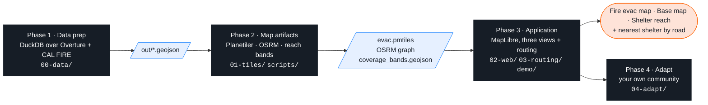

| Phase | You do | Folder |
|---|---|---|
| 1 Data prep | query Overture Maps + CAL FIRE with DuckDB, export GeoJSON | [`00-data/`](00-data/) |
| 2 Map artifacts | one PMTiles file (Planetiler), one routing graph (OSRM), drive-time reach bands | [`01-tiles/`](01-tiles/) · [`scripts/`](scripts/) |
| 3 Application | style three views in MapLibre, wire nearest-shelter routing, run the app | [`02-web/`](02-web/) · [`03-routing/`](03-routing/) · [`demo/`](demo/) |
| 4 Adapt | change one box, rerun the pipeline for your town | [`04-adapt/`](04-adapt/) |

Always run commands from the **repo root**.

## Setup — pick one


### A — GitHub Codespaces

[](https://codespaces.new/vishal4c/routes-to-safety-workshop?quickstart=1)

Or: repository page → green **Code** button → **Codespaces** → **Create codespace on main** (personal GitHub account, free tier is enough).
Three containers start (tool shell, OSRM, Caddy) and the 150 MB data bundle downloads; you land in a terminal with `setup/check_setup.py` already run.
Open the map: **Ports** tab → port **8080** → globe icon. Never forward port 5000; routing is `/osrm` on port 8080.

### B — Docker image on your laptop

Image: **`ghcr.io/vishal4c/routes-to-safety-workshop:latest`** (amd64 + arm64: DuckDB 2.0.0 + spatial, Temurin 21, Planetiler 0.10.2, go-pmtiles 1.31.2, Node 22, osmium-tool, uv).
Needs a container runtime — Docker Desktop, Finch (`finch vm init` once), OrbStack, Colima or Podman; swap `docker` for `finch`/`podman`.

```bash
git clone --depth 1 https://github.com/vishal4c/routes-to-safety-workshop.git
cd routes-to-safety-workshop
docker compose pull            # tool image · OSRM · Caddy  (≈ 1 GB, once)
docker compose up -d
docker compose exec workshop bash
bash scripts/get-bundle.sh     # first time: prebuilt tiles, routing graph, OSM extracts (150 MB, checksum-verified)
python3 setup/check_setup.py
```


| What | Where |
|---|---|
| The repo folder | bind-mounted at `/workspaces/routes-to-safety-workshop` — files you write appear on the laptop and are served at once |
| Map and lab pages | <http://localhost:8080/02-web/> (Caddy answers Range requests, which PMTiles needs) |
| OSRM | browser: same-origin `/osrm/…` · container shell: `$OSRM_URL` = `http://caddy:8080/osrm` |
| Stop / restart | `docker compose down` · `docker compose up -d` |
| Offline room | `BUNDLE_ZIP=/path/data-bundle.zip bash scripts/get-bundle.sh` |

The tool container cannot *build* an OSRM graph (no Docker inside); the graph ships in the bundle, and for your own town you run `scripts/build-osrm.sh` on the laptop (Phase 4).

### C — native tools

Git, DuckDB CLI 2.0.0, Temurin 21, Node 22, uv, go-pmtiles → `bash scripts/get-bundle.sh` → `npx serve -l 8080 .`
(**never** `python -m http.server`: no Range support, blank map). No routing (OSRM has no Windows/macOS binary) — pair up for Phase 3c. Per-OS commands: [`setup/README.md`](setup/).

### Lab 0 — checkpoint

```bash
duckdb -c ".read setup/hello-geo.sql"
```
```
OK — DuckDB 2.0.0 · 10 shelters (1 verified, 9 candidate) · nearest to Colfax (crow-flies): Sierra Vista Community Center, 0.2 km
```
Same line on every screen → ready. Still red after the fixes it prints → switch option, or follow along on the demo site.

---

## Phase 1 — Data prep · [`00-data/`](00-data/)

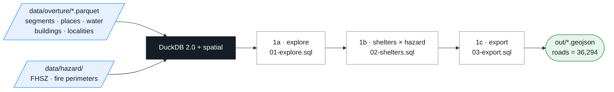

```bash
duckdb -c ".read 00-data/01-explore.sql"      # schema · drivable roads by class (sum 36,294) · top place categories
duckdb -c ".read 00-data/02-shelters.sql"     # 10 candidate shelters, each tagged with its FHSZ class
duckdb -c ".read 00-data/03-export.sql"       # out/*.geojson — 8 files
duckdb -c "LOAD spatial; SELECT count(*) FROM ST_Read('out/roads.geojson')"      # → 36294
```

Expected from 1b — three of the ten candidate shelters sit inside a *Very High* zone:
```
│ Colfax High School            │ candidate │ school           │ Very High        │
│ Georgetown School             │ candidate │ school           │ Very High        │
│ Sierra Vista Community Center │ candidate │ community_center │ Very High        │
```

Behind? `cp data/prebuilt/out/* out/`. Optional extra SQL: [`00-data/exercises.md`](00-data/exercises.md).

---

## Phase 2 — Map artifacts · [`01-tiles/`](01-tiles/) · [`scripts/`](scripts/)

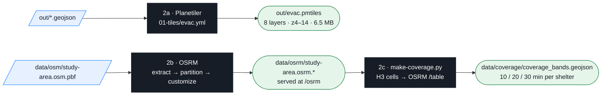

**2a · Tiles**
```bash
01-tiles/build.sh                                   # java -jar planetiler.jar generate-custom --schema=01-tiles/evac.yml … (about 4 s)
pmtiles show out/evac.pmtiles                       # 8 vector layers, min zoom 4, max zoom 14, 1607 tiles
curl -sI -H "Range: bytes=0-15" http://localhost:8080/out/evac.pmtiles | head -1     # HTTP/1.1 206 Partial Content  (container: http://caddy:8080/…)
```
No GeoJSON yet? `01-tiles/build.sh --prebuilt`.

**2b · Routing graph** — already in the bundle and loaded by the `osrm` container. To watch it being built on a tiny clip (laptop, needs Docker/Finch):
```bash
scripts/build-osrm.sh data/osm/colfax.osm.pbf out/osrm
curl "$OSRM_URL/nearest/v1/driving/-121.08,38.90"     # laptop: OSRM_URL=http://localhost:8080/osrm → {"code":"Ok", …}
```

**2c · Reach bands** — drive time from every road-bearing H3 cell (res 8, 3,341 cells) to all 10 shelters, dissolved into non-overlapping 0–10 / 10–20 / 20–30-minute rings per shelter:
```bash
scripts/make-coverage.py --osrm http://osrm:5000      # container; laptop: --osrm http://localhost:8080/osrm  → data/coverage/*.geojson
```

---

## Phase 3 — Application · [`02-web/`](02-web/) · [`03-routing/`](03-routing/) · [`demo/`](demo/)

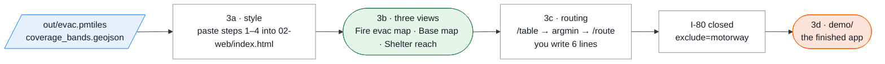

Open <http://localhost:8080/02-web/> (Codespaces: Ports → 8080 → globe → add `/02-web/`) and reload after each paste.

**3a · Style** — in `02-web/index.html` replace `const STEPn = [];` with the matching file from `02-web/steps/`.

| Step 1 — roads (`step1-roads.json`, uncomment `AttributionControl`) | Step 2 — hazard, water, land cover, shelters, labels (`step2-hazard-water.json`) |
|---|---|
| 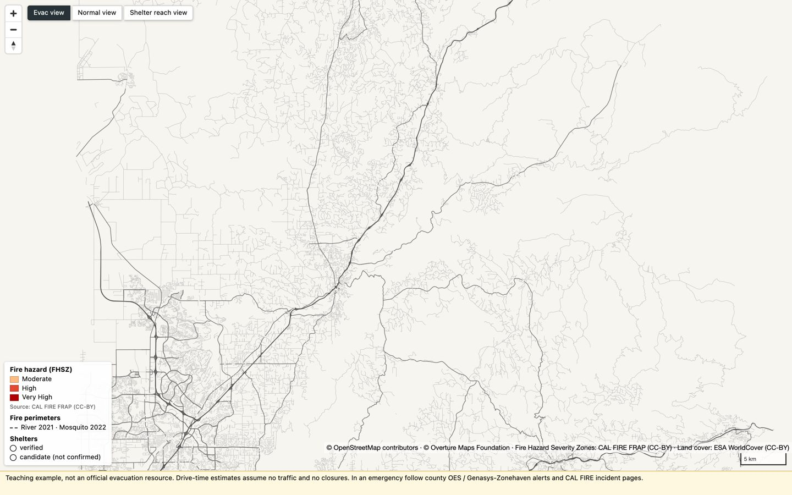 |  |

| Step 3 — fire perimeters (`step3-styled.json`, also contains 1 + 2 = bail-out) | Step 4 — 3D buildings over Auburn, zoom ≥ 13 (`step4-final.json`) |
|---|---|
| 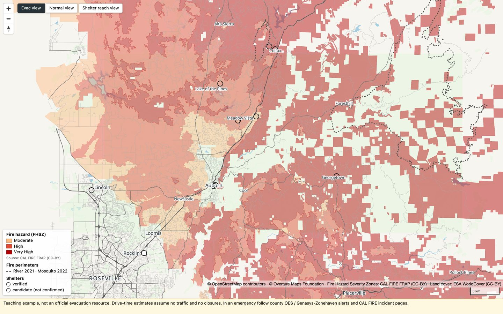 | 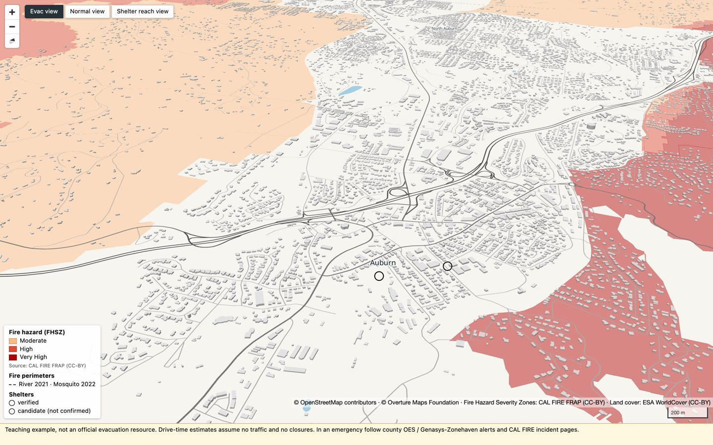 |

**3b · Three views, one at a time** — the buttons top-left flip layer visibility; the legend follows the view; nothing is drawn on top of anything else.

| Fire evac map | Base map | Shelter reach |
|---|---|---|
| 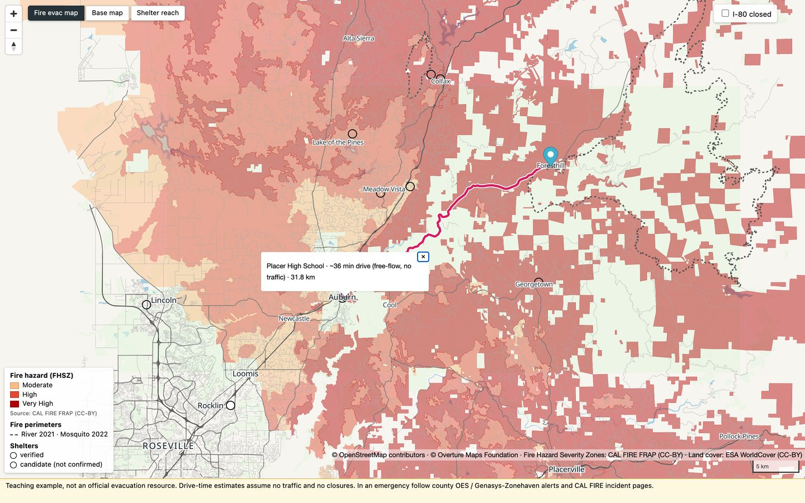 | 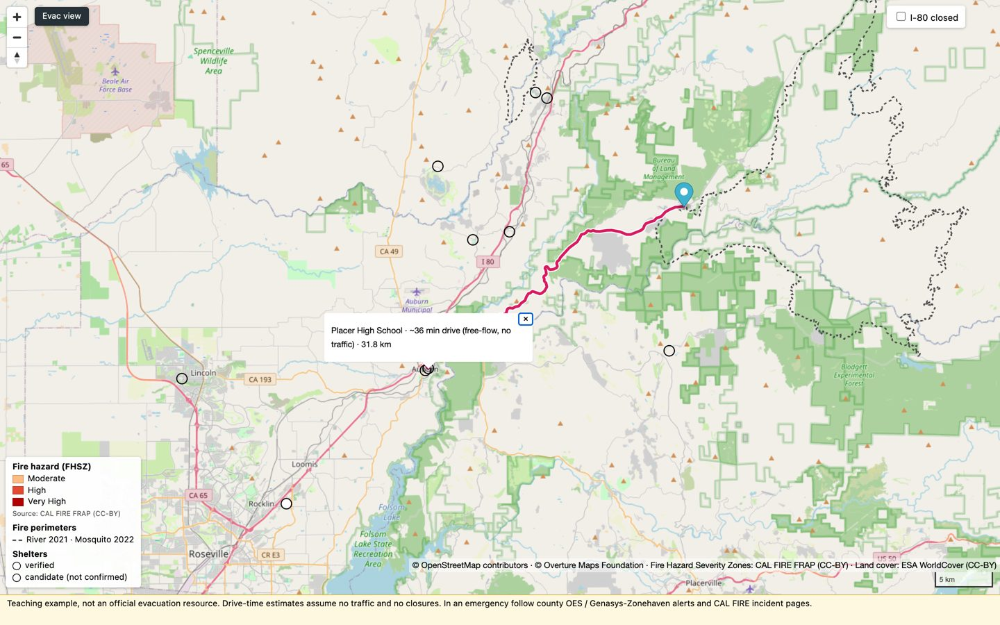 | 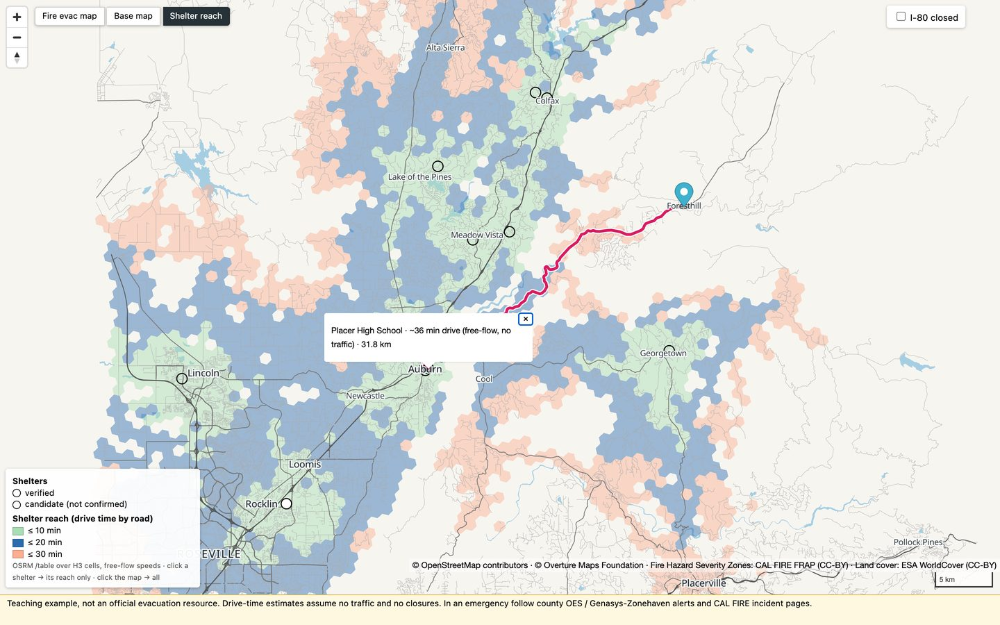 |
| FHSZ Moderate / High / Very High · past perimeters · shelters | OpenStreetMap raster (internet) · shelters | ≤ 10 min green · ≤ 20 blue · ≤ 30 light red · click a shelter for its reach only |

**3c · Routing** — one module, [`03-routing/route.js`](03-routing/route.js); works in every view.

```bash
curl "$OSRM_URL/nearest/v1/driving/-121.08,38.90"                                   # snap a point
curl "$OSRM_URL/table/v1/driving/-120.8182,39.0199;-121.0768,38.8971?sources=0"     # seconds pin → shelter
```
1. In `02-web/index.html` uncomment `import('../03-routing/steps/step1-route.js')` → pink line Foresthill → Placer High School, console `Route: 35.8 min, 31.8 km`.
2. Switch to `steps/step2-scaffold.js`, fill the block `YOU WRITE THESE 6 LINES`: `/table` → drop `durations[0][0]` → argmin → `/route` → `setData` → popup. Answer: `steps/step3-solution.js`.
3. Tick **I-80 closed** → `&exclude=motorway` on both calls.

| Nearest on the map ≠ nearest by road | I-80 open → closed |
|---|---|
|  | 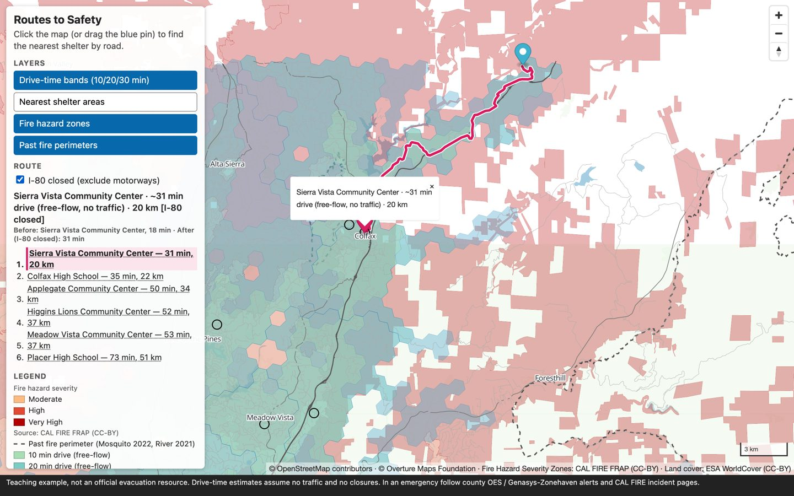 |
| From Foresthill: Georgetown School is 12.4 km away but 59.7 min by road; Placer High is 35.8 min. | From Dutch Flat: Sierra Vista CC stays nearest, 17.9 → **31.3 min** via Dutch Flat Rd / Rollins Lake Rd. |

> A real closure is not a URL parameter. This is the calculation, not detection; shelter status, traffic, smoke and capacity are not in the data.

**3d · The finished app** — [`demo/`](demo/) = the same three views + the router with a small side panel: view switch, legend for the current view, I-80 toggle, result.
Static files only; routing via your Caddy `/osrm` locally, the public OSRM server on GitHub Pages.


<http://localhost:8080/demo/> · URL state: `?lng=&lat=&closed=1&view=reach&shelter=placer-high`

---

## Phase 4 — Adapt the pipeline to your community · [`04-adapt/`](04-adapt/)


```bash
# 1. box around your community (bboxfinder.com, keep it under ~0.5 sq. degrees) → the four BBOX_* lines in versions.env
scripts/make-data.sh --plan                      # 2. prints every query, file and size estimate — downloads nothing
scripts/make-data.sh                             # 3. fetch: overture · hazard · osm · exports  (Geofabrik extract is the big one)
#    4. replace data/shelters.geojson (id, name, status, type, town, source) — mark everything candidate until confirmed
#    5. hazard outside California: swap the source, keep the SQL + style → 04-adapt/README.md#swap-the-hazard
duckdb -c ".read 00-data/03-export.sql"          # 6. rebuild artifacts
01-tiles/build.sh
scripts/build-osrm.sh                            #    laptop (Docker/Finch), then: docker compose restart osrm
scripts/make-coverage.py --osrm http://osrm:5000
#    7. center/zoom in 02-web/index.html and demo/app.js, default pin in 03-routing/route.js
sha256sum -c data/CHECKSUMS.sha256               # 8. verify, then publish out/evac.pmtiles + data/coverage/ + 02-web/ + demo/ to any static host
```

Laptop → planet: same shapes, bigger inputs — [`04-adapt/README.md`](04-adapt/README.md#laptop--planet).

---

## The stack (pinned in [`versions.env`](versions.env))

| Tool | Version | | Tool | Version |
|---|---|---|---|---|
| DuckDB CLI + spatial | 2.0.0 | | MapLibre GL JS | 6.14.0 |
| Temurin / OpenJDK | 21 | | PMTiles (JS) | 4.5.0 |
| Planetiler | v0.10.2 | | Node | 22 |
| go-pmtiles | v1.31.2 | | osmium-tool | 1.19 |
| OSRM | `ghcr.io/project-osrm/osrm-backend:v26.10.0-debian` | | Overture Maps release | 2026-09-23.1 |
| Tool image | `ghcr.io/vishal4c/routes-to-safety-workshop:latest` | | Caddy | `caddy:2-alpine` |

`scripts/check-versions.sh` fails CI if any file drifts from `versions.env`.

## Study area

**Placer County I-80 corridor: Rocklin → Auburn → Colfax → Foresthill.** Bounding box (W,S,E,N) **-121.40, 38.72, -120.52, 39.20**.
River Fire (2021) evacuated Colfax; the Mosquito Fire (2022, 76,771 acres) moved the shelter to Sierra College mid-incident; CAL FIRE's Very High zone rings Auburn and Colfax; I-80 is the lifeline.

## Licensing and attribution

- **Code** (scripts, config, JS): [MIT](LICENSE) · **Materials** (slides, docs, exercises): [CC BY-SA 4.0](LICENSE-materials) ·
  **Data** keeps its source licences: [`data/LICENSE-data.md`](data/LICENSE-data.md); provenance: [`data/README.md`](data/README.md).
- Keep this line on every map: **© OpenStreetMap contributors · © Overture Maps Foundation · Fire Hazard Severity Zones: CAL FIRE FRAP (CC-BY) · Land cover: ESA WorldCover (CC-BY)**.

Slides: [`slides/`](slides/) · instructor material: [`instructor/`](instructor/).

## Instructors

**Vishal Kumar** · **Shaishav Maisuria** — Amazon Maps. The workshop teaches only the public open stack.
