# Routes to Safety — a wildfire-evacuation map from open data

Hands-on workshop for **FOSS4G North America 2026** · Sacramento, CA · Mon Nov 2, 2026 · room Beavis.
You build an evacuation map for the **Placer County I-80 corridor** from open data and open tools, then ask it:
*which shelter can I reach by road, and how long does it take if I-80 is closed?*

**Finished result:** <https://vishal4c.github.io/routes-to-safety-workshop/demo/>

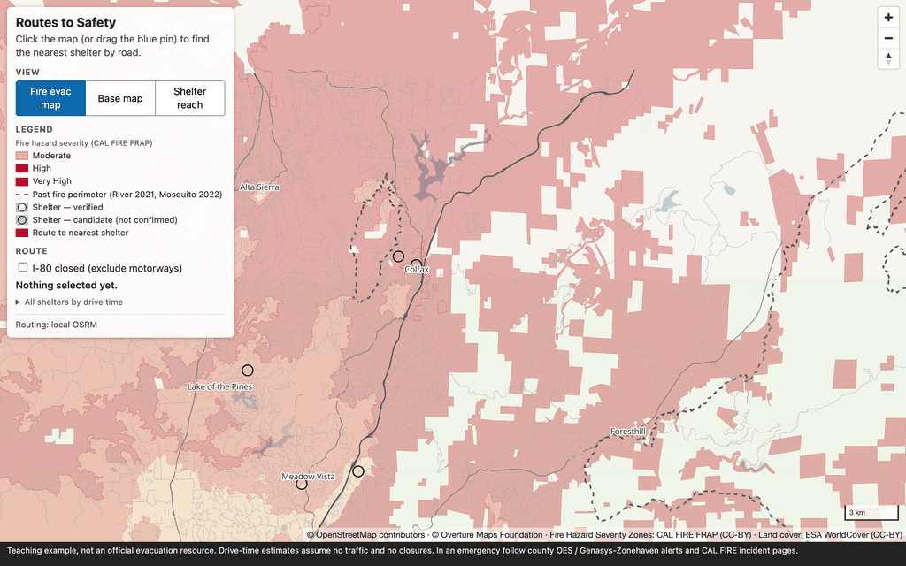

> **Teaching example, not an official evacuation resource.** Drive-time estimates assume no traffic and no closures.
> In an emergency follow county OES / Genasys-Zonehaven alerts and CAL FIRE incident pages.

## Five phases

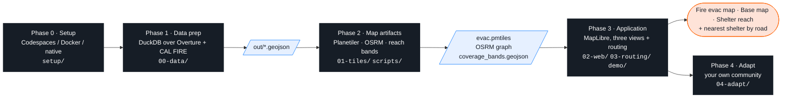

| Phase | Name | Steps | Folder |
|---|---|---|---|
| 0 | Setup | pick Codespaces / Docker / native · checkpoint line | [`setup/`](setup/) |
| 1 | Data prep | 1a explore · 1b shelters × hazard · 1c export | [`00-data/`](00-data/) |
| 2 | Map artifacts | 2a tiles · 2b routing graph · 2c reach rings | [`01-tiles/`](01-tiles/) · [`scripts/`](scripts/) |
| 3 | Application | 3a style · 3b three views · 3c routing · 3d finished app | [`02-web/`](02-web/) · [`03-routing/`](03-routing/) · [`demo/`](demo/) |
| 4 | Adapt | one bbox → rerun | [`04-adapt/`](04-adapt/) |

Always run commands from the **repo root**.

## Phase 0 — Setup · pick one way to run

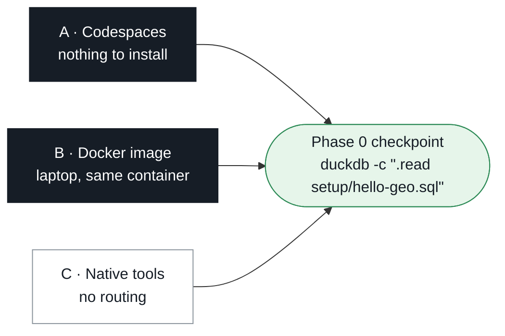

### A — GitHub Codespaces

[](https://codespaces.new/vishal4c/routes-to-safety-workshop?quickstart=1)

Or: repository page → green **Code** button → **Codespaces** → **Create codespace on main** (personal GitHub account, free tier is enough).
Three containers start (tool shell, OSRM, Caddy) and the 150 MB data bundle downloads; you land in a terminal with `setup/check_setup.py` already run.
Open the map: **Ports** tab → port **8080** → globe icon. Never forward port 5000; routing is `/osrm` on port 8080.

### B — Docker image on your laptop

Image: **`ghcr.io/vishal4c/routes-to-safety-workshop:latest`** (amd64 + arm64: DuckDB 2.0.0 + spatial, Temurin 21, Planetiler 0.10.2, go-pmtiles 1.31.2, Node 22, osmium-tool, uv).
Needs a container runtime — Docker Desktop, Finch (`finch vm init` once), OrbStack, Colima or Podman; swap `docker` for `finch`/`podman`.

```bash
git clone --depth 1 https://github.com/vishal4c/routes-to-safety-workshop.git
cd routes-to-safety-workshop
docker compose pull            # tool image · OSRM · Caddy  (≈ 1 GB, once)
docker compose up -d
docker compose exec workshop bash
bash scripts/get-bundle.sh     # first time: prebuilt tiles, routing graph, OSM extracts (150 MB, checksum-verified)
python3 setup/check_setup.py
```

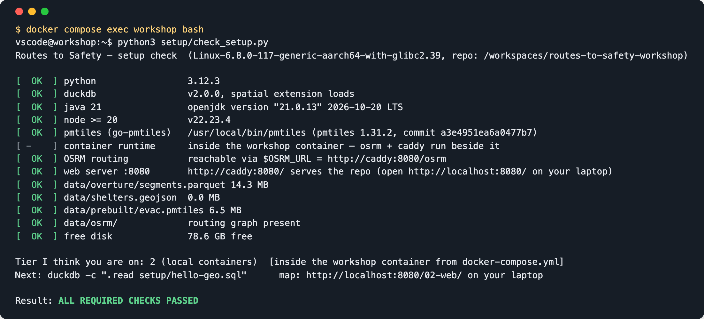

| What | Where |
|---|---|
| The repo folder | bind-mounted at `/workspaces/routes-to-safety-workshop` — files you write appear on the laptop and are served at once |
| Map and hands-on pages | <http://localhost:8080/02-web/> (Caddy answers Range requests, which PMTiles needs) |
| OSRM | browser: same-origin `/osrm/…` · container shell: `$OSRM_URL` = `http://caddy:8080/osrm` |
| Stop / restart | `docker compose down` · `docker compose up -d` |
| Offline room | `BUNDLE_ZIP=/path/data-bundle.zip bash scripts/get-bundle.sh` |

The tool container cannot *build* an OSRM graph (no Docker inside); the graph ships in the bundle, and for your own town you run `scripts/build-osrm.sh` on the laptop (Phase 4).

### C — native tools

Install Git, DuckDB CLI 2.0.0, Temurin 21, Node 22, uv, go-pmtiles ([per-OS commands](setup/README.md#tier-3--native-no-containers-no-routing)), then:

```bash
git clone --depth 1 https://github.com/vishal4c/routes-to-safety-workshop.git && cd routes-to-safety-workshop
bash scripts/get-bundle.sh       # run this before check_setup (150 MB, checksum-verified)
python3 setup/check_setup.py     # the OSRM and web-server lines are red here — expected without containers
npx serve -l 8080 .              # never `python -m http.server` (no Range support → blank map); another port is fine, swap it in every URL below
export WEB_URL=http://localhost:8080             # in a second terminal; the checks below use it
```
No routing without containers (OSRM has no Windows/macOS binary). Have Docker anyway? `docker compose up -d osrm caddy` serves the repo on :8080 **and** adds routing — skip `npx serve`, and `export OSRM_URL=http://localhost:8080/osrm`. Otherwise pair up for Phase 3c.

**Where to type.** Options A and B: every command in this README runs in the **tool container shell** — the terminal Codespaces opens, or `docker compose exec workshop bash` (prompt `vscode ➜ /workspaces/routes-to-safety-workshop`). It has every tool, and `$WEB_URL` (`http://caddy:8080`) and `$OSRM_URL` (`http://caddy:8080/osrm`) are preset there; `localhost` inside it is the container itself, not Caddy. Your browser reaches the same server at `http://localhost:8080`. The only commands that run in a **laptop terminal** (your own shell, in the clone folder) are `docker compose …` and `scripts/build-osrm.sh` — both marked below. Option C: everything is the laptop terminal, with the two variables exported as above.

### Phase 0 — setup checkpoint

```bash
duckdb -c ".read setup/hello-geo.sql"
```
```
OK — DuckDB 2.0.0 · 10 shelters (1 verified, 9 candidate) · nearest to Colfax (crow-flies): Sierra Vista Community Center, 0.2 km
```
Same line on every screen → ready. Still red after the fixes it prints → switch option (`check_setup.py` calls them tiers 1–3), or follow along on the demo site.

---

## Phase 1 — Data prep · [`00-data/`](00-data/)


```bash
duckdb -c ".read 00-data/01-explore.sql"      # schema · drivable roads by class (sum 36,294) · top place categories
duckdb -c ".read 00-data/02-shelters.sql"     # 10 candidate shelters, each tagged with its FHSZ class
duckdb -c ".read 00-data/03-export.sql"       # prints nothing; `ls out/` → 8 GeoJSON files
duckdb -c "LOAD spatial; SELECT count(*) FROM ST_Read('out/roads.geojson')"      # → 36294
```

Expected from 1b — three of the ten candidate shelters sit inside a *Very High* zone:
```
│ Colfax High School            │ candidate │ school           │ Very High        │
│ Georgetown School             │ candidate │ school           │ Very High        │
│ Sierra Vista Community Center │ candidate │ community_center │ Very High        │
```

Behind? `cp data/prebuilt/out/* out/`. Optional extra SQL: [`00-data/exercises.md`](00-data/exercises.md).

---

## Phase 2 — Map artifacts · [`01-tiles/`](01-tiles/) · [`scripts/`](scripts/)


**2a · Tiles**
```bash
01-tiles/build.sh                                   # java -jar planetiler.jar generate-custom --schema=01-tiles/evac.yml … (about 4 s)
pmtiles show out/evac.pmtiles                       # 8 vector layers, min zoom 4, max zoom 14, 1607 tiles
curl -sSI -H "Range: bytes=0-15" "$WEB_URL/out/evac.pmtiles" | head -1     # HTTP/1.1 206 Partial Content — anything else means the wrong server
```
No GeoJSON yet? `01-tiles/build.sh --prebuilt`.

**2b · Routing graph** — already in the bundle and served by the `osrm` container:
```bash
curl "$OSRM_URL/nearest/v1/driving/-121.08,38.90"     # → {"code":"Ok", …}  the graph answers
```
Optional — watch a graph being built on a tiny clip. **Laptop terminal**, in the clone folder (needs Docker/Finch; the tool container has no Docker inside it):
```bash
scripts/build-osrm.sh data/osm/colfax.osm.pbf out/osrm     # about 1 min → out/osrm/colfax.osrm.*
```

**2c · Reach bands** — drive time from every road-bearing H3 cell (res 8, 3,341 cells) to all 10 shelters, dissolved into non-overlapping 0–10 / 10–20 / 20–30-minute rings per shelter:
```bash
scripts/make-coverage.py --osrm http://osrm:5000      # about 4 s · overwrites data/coverage/*.geojson · run as written (uv shebang) · Option C: --osrm $OSRM_URL
```

---

## Phase 3 — Application · [`02-web/`](02-web/) · [`03-routing/`](03-routing/) · [`demo/`](demo/)

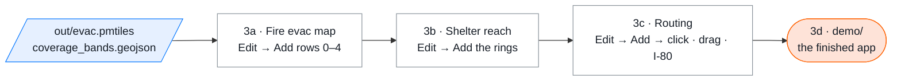

Open <http://localhost:8080/02-web/> (Codespaces: Ports → 8080 → globe → add `/02-web/`). The map is blank. Click **Edit** (top-left): a panel lists the data files, one row each, with an **Add** button. Clicking **Add** puts that file into the map. **You type and edit nothing in this phase** — every step below is one click. What you add stays until you refresh the page.

### 3a · Style — stay on **Fire evac map**, click **Edit**, then **Add** on each row, top to bottom

**0 · Tiles → Add.** Map still blank; rows 1–4 unlock. (A note "Using the prebuilt tiles" means your `out/evac.pmtiles` from 2a was not found — fine, carry on.)

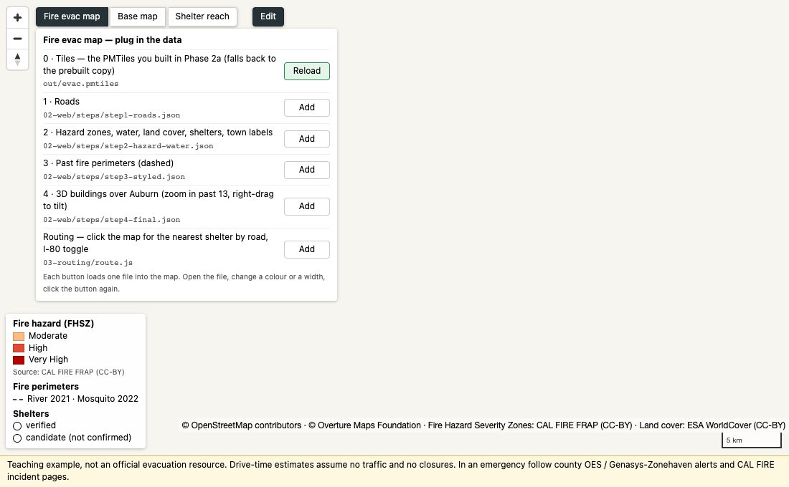

**1 · Roads → Add.** Grey road network.

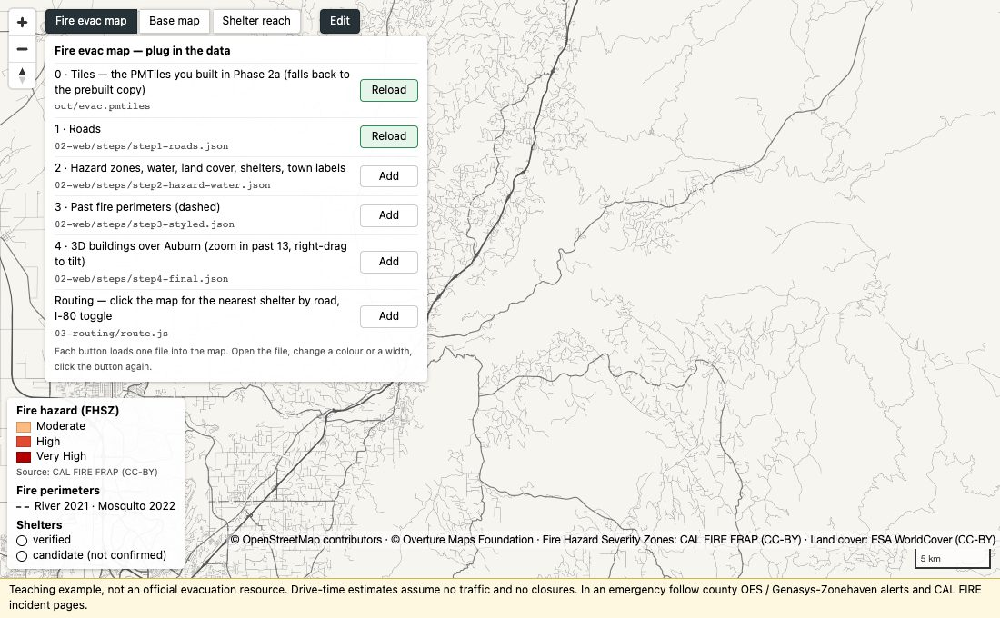

**2 · Hazard zones, water, land cover, shelters, town labels → Add.** The map now matches the legend: Moderate / High / Very High fill, blue water, green land cover, 10 shelter circles (filled = verified), town names.

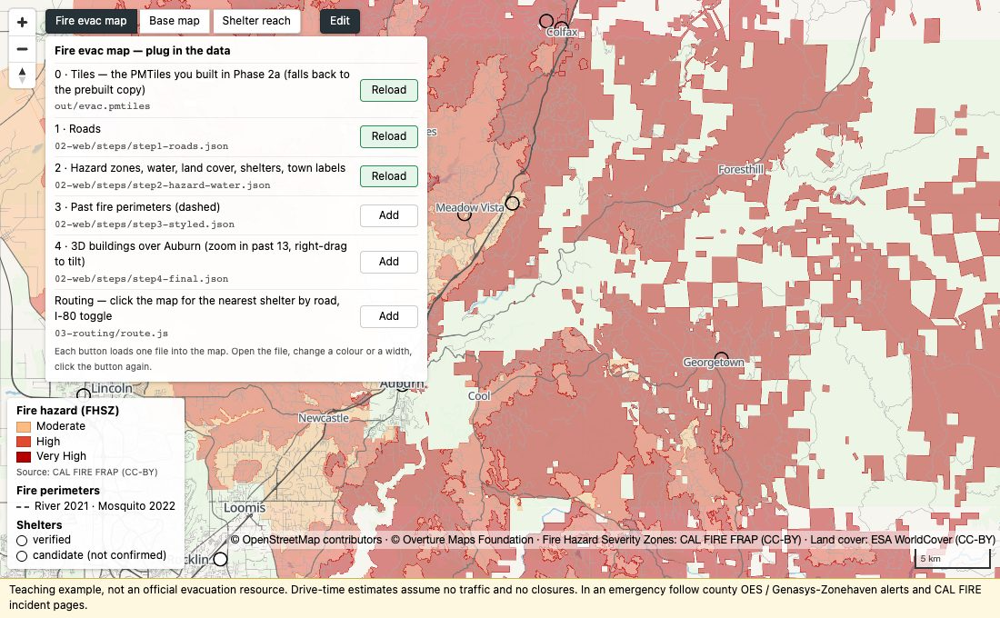

**3 · Past fire perimeters → Add.** Thin dashed outlines of the Mosquito 2022 and River 2021 fires (north-east, around Foresthill and Colfax).

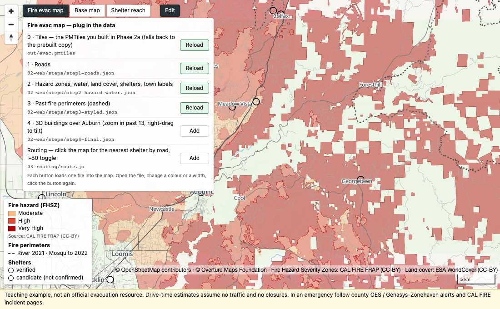

**4 · 3D buildings → Add**, then zoom in over Auburn (past zoom 13) and right-drag to tilt.

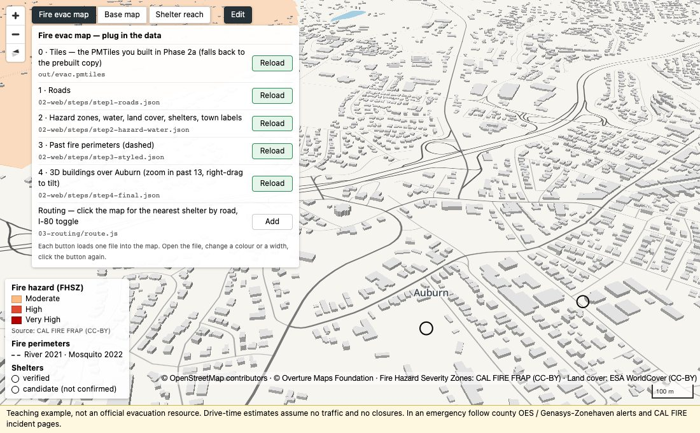

Want to change a colour or a width? Open that row's JSON file (`02-web/steps/…`), edit, click the row's **Reload**. Lost? `02-web/solution.html` is the page with everything added.

### 3b · Shelter reach — click **Shelter reach** (top-left), then **Edit**

**Reach rings → Add.** Hexagon bands around every shelter: green ≤ 10 min · blue ≤ 20 · light red ≤ 30 min drive (Phase 2c output). Click a shelter to see only its rings; click the map to see all again. (Rows 0 and 1+2 are already green if you did 3a; if not, Add them first.)

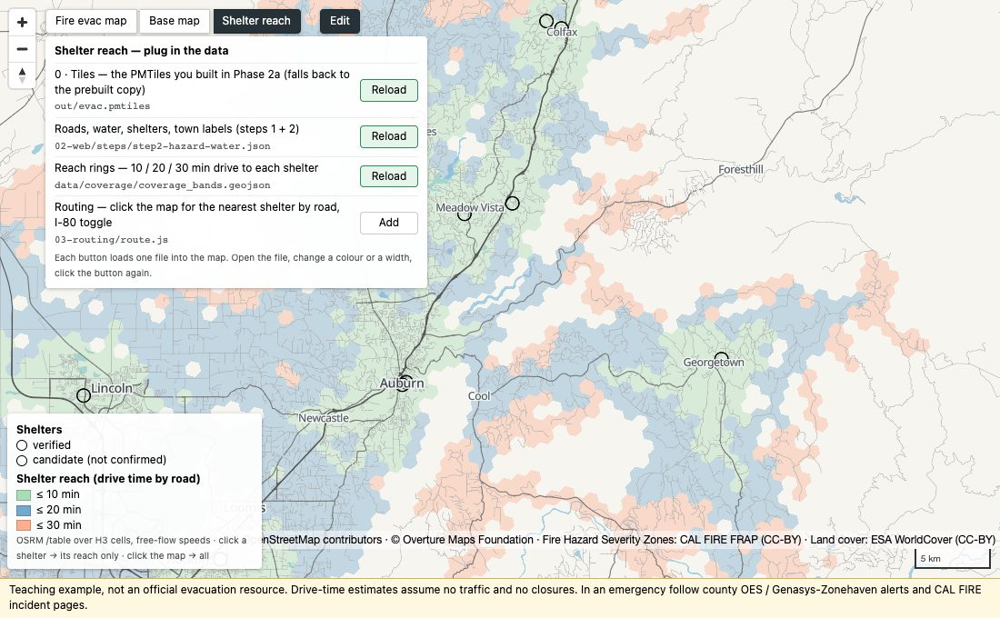

**Base map** (the third button) needs nothing added: OpenStreetMap under the shelters, internet required.

### 3c · Routing — in any view, **Edit** → **Routing → Add**

**Routing → Add.** A pin drops on Foresthill and a pink line is drawn to the nearest shelter **by road**: Placer High School, ~36 min, 31.8 km. Nothing to write.

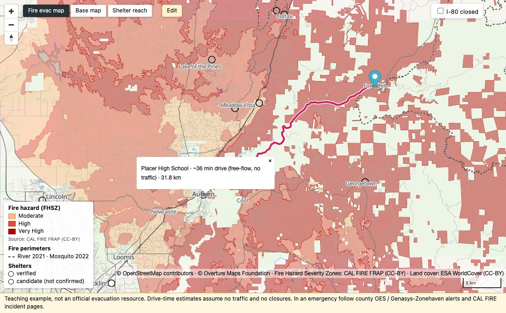

**Drag the pin**, then tick **I-80 closed** (top-right). The route recomputes without the motorway. From Gold Run: Sierra Vista CC 13 min → **21 min**.

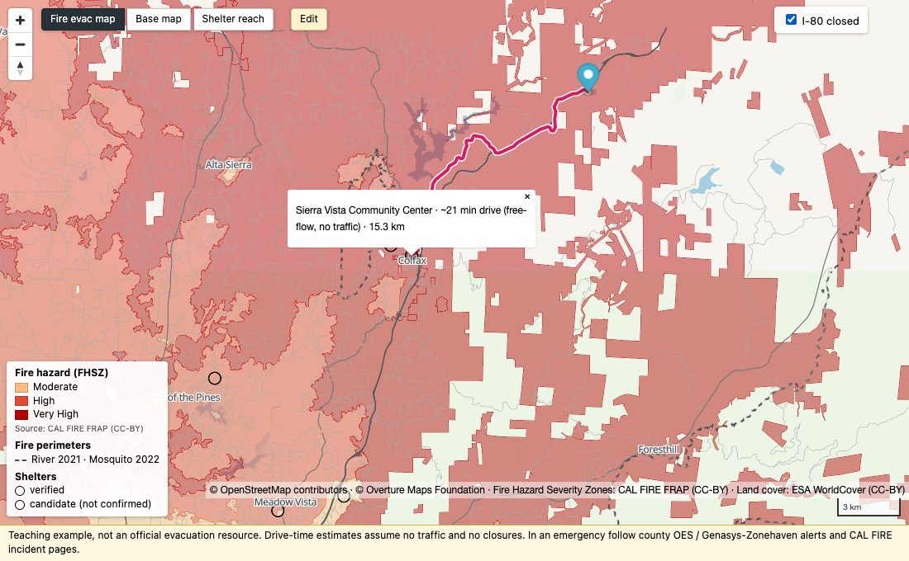

Nearest on the map ≠ nearest by road: from Foresthill, Georgetown School is 12.4 km away but 59.7 min; Placer High is 35.8 min. Under the hood it is two calls to OSRM — `/table` (seconds from the pin to every shelter, pick the smallest) and `/route` (the line); I-80 closed adds `&exclude=motorway` to both. Want to write those 6 lines yourself instead of clicking Add? → [`03-routing/README.md`](03-routing/README.md).

> A real closure is not a URL parameter. This is the calculation, not detection; shelter status, traffic, smoke and capacity are not in the data.

### 3d · The finished app — [`demo/`](demo/)

The same three views + the router with a side panel (view switch, legend, I-80 toggle, result). Static files only. <http://localhost:8080/demo/> · URL state: `?lng=&lat=&closed=1&view=reach&shelter=placer-high`

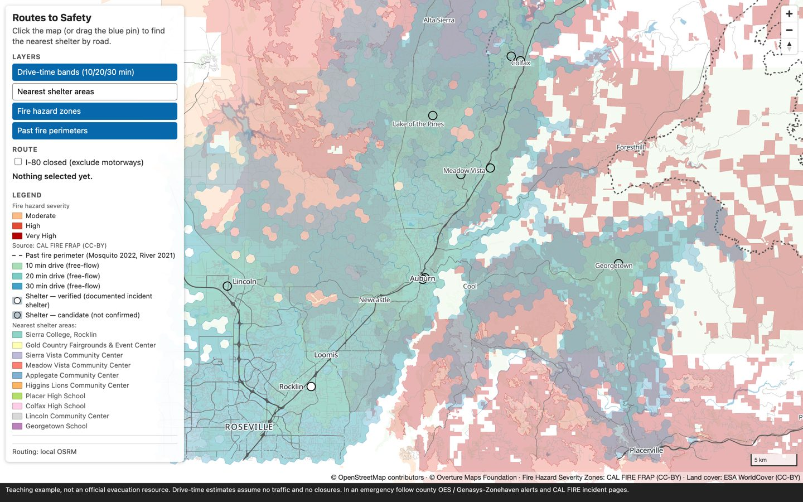

---

## Phase 4 — Adapt the pipeline to your community · [`04-adapt/`](04-adapt/)

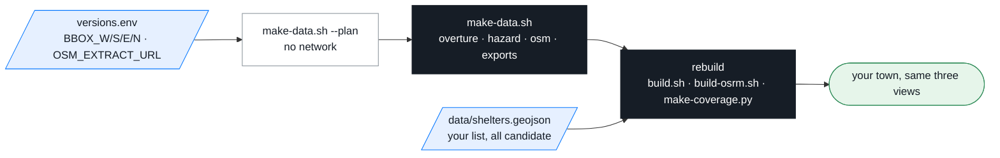

```bash
# 1. box around your community (bboxfinder.com, keep it under ~0.5 sq. degrees) → the four BBOX_* lines in versions.env
scripts/make-data.sh --plan                      # 2. prints every query, file and size estimate — downloads nothing
scripts/make-data.sh                             # 3. fetch: overture · hazard · osm · exports  (Geofabrik extract is the big one)
#    4. replace data/shelters.geojson (id, name, status, type, town, source) — mark everything candidate until confirmed
#    5. hazard outside California: swap the source, keep the SQL + style → 04-adapt/README.md#swap-the-hazard
duckdb -c ".read 00-data/03-export.sql"          # 6. rebuild artifacts
01-tiles/build.sh
scripts/build-osrm.sh                            #    laptop terminal (Docker/Finch), then: docker compose restart osrm
scripts/make-coverage.py --osrm http://osrm:5000
#    7. center/zoom in 02-web/index.html and demo/app.js, default pin in 03-routing/route.js
sha256sum -c data/CHECKSUMS.sha256               # 8. verify, then publish out/evac.pmtiles + data/coverage/ + 02-web/ + demo/ to any static host
```

Laptop → planet: same shapes, bigger inputs — [`04-adapt/README.md`](04-adapt/README.md#laptop--planet).

---

## Stop everything

**Laptop terminal**, in the clone folder:
```bash
docker compose down              # stops and removes the three containers; images stay cached (`docker compose up -d` brings it back in seconds)
docker compose down --rmi all    # the same, plus delete the 3 GB of images
```
Option C: `Ctrl-C` in the `npx serve` terminal. Something still holding :8080? `lsof -nP -iTCP:8080 -sTCP:LISTEN` (Windows: `netstat -ano | findstr :8080`), then `kill <PID>`.
Codespaces: <https://github.com/codespaces> → … → **Stop codespace** (it also stops itself after 30 idle minutes).

## The stack (pinned in [`versions.env`](versions.env))

| Tool | Version | | Tool | Version |
|---|---|---|---|---|
| DuckDB CLI + spatial | 2.0.0 | | MapLibre GL JS | 6.14.0 |
| Temurin / OpenJDK | 21 | | PMTiles (JS) | 4.5.0 |
| Planetiler | v0.10.2 | | Node | 22 |
| go-pmtiles | v1.31.2 | | osmium-tool | 1.19 |
| OSRM | `ghcr.io/project-osrm/osrm-backend:v26.10.0-debian` | | Overture Maps release | 2026-09-23.1 |
| Tool image | `ghcr.io/vishal4c/routes-to-safety-workshop:latest` | | Caddy | `caddy:2-alpine` |

`scripts/check-versions.sh` fails CI if any file drifts from `versions.env`.

## Study area

**Placer County I-80 corridor: Rocklin → Auburn → Colfax → Foresthill.** Bounding box (W,S,E,N) **-121.40, 38.72, -120.52, 39.20**.
River Fire (2021) evacuated Colfax; the Mosquito Fire (2022, 76,771 acres) moved the shelter to Sierra College mid-incident; CAL FIRE's Very High zone rings Auburn and Colfax; I-80 is the lifeline.

## Licensing and attribution

- **Code** (scripts, config, JS): [MIT](LICENSE) · **Materials** (slides, docs, exercises): [CC BY-SA 4.0](LICENSE-materials) ·
  **Data** keeps its source licences: [`data/LICENSE-data.md`](data/LICENSE-data.md); provenance: [`data/README.md`](data/README.md).
- Keep this line on every map: **© OpenStreetMap contributors · © Overture Maps Foundation · Fire Hazard Severity Zones: CAL FIRE FRAP (CC-BY) · Land cover: ESA WorldCover (CC-BY)**.

Slides: [`slides/`](slides/) · instructor material: [`instructor/`](instructor/).

## Instructors

**Vishal Kumar** · **Shaishav Maisuria** — Amazon Maps. The workshop teaches only the public open stack.
