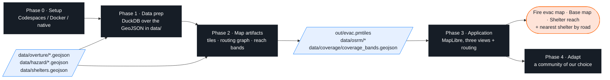
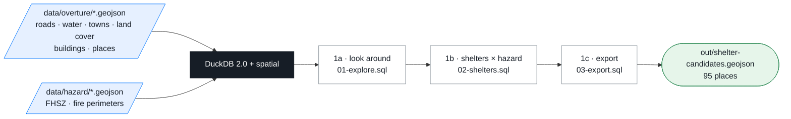

# Routes to Safety — an evacuation-services map from open geospatial data

Hands-on workshop for **FOSS4G North America 2026** · Sacramento, CA · Mon Nov 2, 2026 · room Beavis.

In this workshop we will build an **evacuation-services map** for the **Placer County I-80 corridor** — shelters, fire-hazard zones and the roads that connect them — and use it to answer a route-based question: *which shelter can I reach by road, and how long does it take if I-80 is closed?* In the last phase we point the same pipeline at a community of our choice.

**Tech stack we will use**

| | Topic | Hands-on with |
|---|---|---|
| 1 | **Open geospatial datasets** — what is in OpenStreetMap, the Overture Maps themes (transportation, places, divisions, base, buildings) and public hazard layers (CAL FIRE); how to pull a study area out of a planet-wide release in seconds, and how to read and write GeoJSON with SQL | DuckDB + spatial |
| 2 | **Tile generation** — turning GeoJSON into vector tiles, and serving the whole map as one static file with no tile server | Planetiler · PMTiles |
| 3 | **Routing engines for route-based analysis** — building a routing graph from an OpenStreetMap extract, then `/nearest`, `/table` and `/route` for nearest-shelter-by-road, drive-time reach bands (isochrones) and what-if closures | OSRM |
| 4 | **Rendering** — a MapLibre style, three views over the same tiles, and routing wired into the page | MapLibre GL JS |

**Finished result:** <https://vishal4c.github.io/routes-to-safety-workshop/demo/>


> **Teaching example, not an official evacuation resource.** Drive-time estimates assume no traffic and no closures.
> In an emergency follow county OES / Genasys-Zonehaven alerts and CAL FIRE incident pages.

## What we will build — five phases



| Phase | Steps | We end up with |
|---|---|---|
| 0 Setup | pick Codespaces / Docker / native · one checkpoint line | a shell with every tool, a web server on :8080 |
| 1 Data prep | 1a look around · 1b shelters × hazard · 1c export | we can read and write GeoJSON with SQL |
| 2 Map artifacts | 2a tiles · 2b routing graph · 2c reach bands | the **three files** the app needs |
| 3 Application | 3a style · 3b shelter reach · 3c routing · 3d finished app | the map, three views, nearest shelter by road |
| 4 Adapt | one box → the same steps for a community of our choice | our town, same three views |

**This page is the whole workshop.** Every command is here, in order; folders are listed in the [repository map](#repository-map) at the end. Blocks that start with **▸ Optional** open on click and can be skipped on the day. Every command runs from the **repo root**; where to type them is explained once, in Phase 0.

## Phase 0 — Setup · pick one way to run


| | For | Routing | Works without wifi |
|---|---|---|---|
| **A** Codespaces | no Docker on the laptop, corporate laptop | yes | no |
| **B** Docker image — *recommended wherever containers can run* | wants everything local | yes | yes* |
| **C** Native tools | containers blocked | **no** (pair with a neighbour) | yes* |

\* Data, tiles and routing are all local. The one exception is the map page itself: it loads the MapLibre and PMTiles JavaScript libraries from unpkg.com, so the first page load needs a connection (the browser caches them afterwards).

`setup/check_setup.py` calls these tiers 1, 2 and 3. Browser only? <https://vishal4c.github.io/routes-to-safety-workshop/> has the slides, the demo and the map page (no routing, nothing to install).

### A — GitHub Codespaces

[](https://codespaces.new/vishal4c/routes-to-safety-workshop?quickstart=1)

Or: repository page → green **Code** button → **Codespaces** → **Create codespace on main**. Use a **personal** GitHub account (employer-managed accounts often block Codespaces); the free tier is enough.
Three containers start (tool shell, OSRM, Caddy — the same images as option B, pulled; Codespaces adds one small layer for its Docker helper), the 143 MB data bundle downloads and `setup/check_setup.py` runs automatically. After 3–5 minutes we land in a terminal.
Open the map: **Ports** tab → row **8080** → globe icon. Never type `localhost:8080` into the laptop's own browser there, and **never forward port 5000** — routing is `/osrm` on port 8080. Smoke test: `docker ps` lists three containers.

### B — Docker image on the laptop

Image: **`ghcr.io/vishal4c/routes-to-safety-workshop:latest`** (amd64 + arm64: DuckDB 2.0.0 + spatial, Temurin 21, Planetiler 0.10.2, go-pmtiles 1.31.2, Node 22, osmium-tool, uv).
Needs a container runtime: **Finch** (`brew install --cask finch` or `winget install Amazon.Finch`, then `finch vm init` once — recommended on corporate laptops), Docker Desktop, OrbStack, Colima or Podman. Swap `docker` for `finch` / `podman` below; the scripts auto-detect `docker → finch → podman → nerdctl`.

```bash
git clone --depth 1 https://github.com/vishal4c/routes-to-safety-workshop.git
cd routes-to-safety-workshop
docker compose pull            # tool image · OSRM · Caddy  (≈ 1 GB, once)
docker compose up -d           # OSRM waits politely until the graph arrives in the next step
docker compose exec workshop bash
bash scripts/get-bundle.sh     # first time: prebuilt tiles, routing graph, OSM extracts (143 MB, checksum-verified)
python3 setup/check_setup.py
```


| What | Where |
|---|---|
| The repo folder | bind-mounted at `/workspaces/routes-to-safety-workshop` — files written there appear on the laptop and are served at once |
| Map and hands-on pages | <http://localhost:8080/02-web/> (Caddy answers Range requests, which PMTiles needs) |
| OSRM | browser: same-origin `/osrm/…` · container shell: `$OSRM_URL` = `http://caddy:8080/osrm` |
| Stop / restart | `docker compose down` · `docker compose up -d` |
| Offline room | `BUNDLE_ZIP=/path/data-bundle.zip bash scripts/get-bundle.sh` |

### C — native tools

Install Git, DuckDB CLI 2.0.0, Temurin 21, Node 22, uv and go-pmtiles, then:

```bash
git clone --depth 1 https://github.com/vishal4c/routes-to-safety-workshop.git && cd routes-to-safety-workshop
bash scripts/get-bundle.sh       # 143 MB, checksum-verified
python3 setup/check_setup.py     # the OSRM and web-server lines are red here — expected without containers
npx serve -l 8080 .              # never `python -m http.server` (no Range support → blank map); another port is fine, swap it in every URL
export WEB_URL=http://localhost:8080             # in a second terminal; the checks below use it
```
No routing without containers (OSRM has no Windows/macOS binary). Have Docker anyway? `docker compose up -d osrm caddy` serves the repo on :8080 **and** adds routing — skip `npx serve`, and `export OSRM_URL=http://localhost:8080/osrm`.

<details><summary><b>▸ Install commands per OS</b> (option C)</summary>

**macOS (Homebrew)**
```bash
brew install duckdb                    # check: duckdb --version → v2.0.0
brew install --cask temurin@21
brew install node@22                   # or: brew install node
brew install uv
brew install pmtiles                   # go-pmtiles. NOT `pip/conda install pmtiles`
```
**Windows (winget, then use Git Bash)**
```powershell
winget install Git.Git
winget install DuckDB.cli
winget install EclipseAdoptium.Temurin.21.JDK
winget install OpenJS.NodeJS.LTS
winget install astral-sh.uv
# go-pmtiles: download go-pmtiles_1.31.2_Windows_x86_64.zip from https://github.com/protomaps/go-pmtiles/releases/tag/v1.31.2
# and unzip pmtiles.exe into a folder on PATH, e.g. %USERPROFILE%\bin
```
Close and reopen Git Bash afterwards so PATH refreshes. If `duckdb` is older than 2.0.0, download `duckdb-cli-windows-amd64.tar.gz` from the DuckDB v2.0.0 release page instead.

**Linux (Debian/Ubuntu)**
```bash
sudo apt update && sudo apt install -y curl unzip git python3 osmium-tool
sudo mkdir -p /etc/apt/keyrings && curl -fsSL https://packages.adoptium.net/artifactory/api/gpg/key/public | sudo tee /etc/apt/keyrings/adoptium.asc >/dev/null
echo "deb [signed-by=/etc/apt/keyrings/adoptium.asc] https://packages.adoptium.net/artifactory/deb $(. /etc/os-release; echo $VERSION_CODENAME) main" | sudo tee /etc/apt/sources.list.d/adoptium.list
sudo apt update && sudo apt install -y temurin-21-jdk
curl -fsSL https://deb.nodesource.com/setup_22.x | sudo -E bash - && sudo apt install -y nodejs
curl -fsSL https://github.com/duckdb/duckdb/releases/download/v2.0.0/duckdb-cli-linux-amd64.tar.gz | sudo tar -xz -C /usr/local/bin duckdb      # arm64 on ARM
curl -fsSL https://github.com/protomaps/go-pmtiles/releases/download/v1.31.2/go-pmtiles_1.31.2_Linux_x86_64.tar.gz | sudo tar -xz -C /usr/local/bin pmtiles
curl -LsSf https://astral.sh/uv/install.sh | sh
```
Alternative: `pixi install && pixi shell` (`pixi.toml`) gives DuckDB, Java 21, Node, osmium, uv — but **no pmtiles** (the conda-forge package of that name is a Python library); install the go-pmtiles binary as above.

**Windows: Git Bash → PowerShell** — use Git Bash where possible. If PowerShell is the only option:

| Git Bash | PowerShell |
|---|---|
| `bash scripts/get-bundle.sh` | `powershell -ExecutionPolicy Bypass -File scripts\get-bundle.ps1` |
| `01-tiles/build.sh` | `powershell -ExecutionPolicy Bypass -File 01-tiles\build.ps1` |
| `python3 setup/check_setup.py` | `python setup\check_setup.py` |
| `duckdb -c ".read 00-data/01-explore.sql"` | same |
| `ls out/` · `cat file` · `cp a b` | `Get-ChildItem out\` · `Get-Content file` · `Copy-Item a b` (the aliases `ls`, `cat`, `cp` also work) |
| `export VAR=value` | `$env:VAR = "value"` |
| `curl -s URL` | `curl.exe -s URL` (plain `curl` is an alias for Invoke-WebRequest) |
| `sha256sum file` | `Get-FileHash file -Algorithm SHA256` |
| `java …`, `pmtiles …`, `npx serve -l 8080 .`, `docker compose up -d` | same |

</details>

### Where to type — read once, it holds for every phase

- **Options A and B:** every command on this page runs in the **tool container shell** — the terminal Codespaces opens, or `docker compose exec workshop bash` on the laptop (prompt `vscode ➜ /workspaces/routes-to-safety-workshop`). It has every tool. `$WEB_URL` (`http://caddy:8080`) and `$OSRM_URL` (`http://caddy:8080/osrm`) are preset there; `localhost` *inside* that shell is the container itself, not the web server.
- **The browser** reaches the same server at `http://localhost:8080` (Codespaces: Ports → 8080 → globe).
- **Two exceptions, marked "laptop terminal" where they appear:** `docker compose …` (start / stop / restart the containers) and `scripts/build-osrm.sh` (it runs the OSRM container, so it needs Docker where it is typed). In Codespaces the one terminal does both.
- **Option C:** everything is the laptop terminal, with `WEB_URL` and `OSRM_URL` exported as above.
- Always from the **repo root** (the folder with `versions.env`).

### Phase 0 checkpoint

```bash
duckdb -c ".read setup/hello-geo.sql"
```
```
OK — DuckDB 2.0.0 · 10 shelters (1 verified, 9 candidate) · nearest to Colfax (crow-flies): Sierra Vista Community Center, 0.2 km
```
Same line on every screen → ready. Still red after the fixes `check_setup.py` prints → switch option, or follow along on the demo site.

---

## Phase 1 — Data prep · look at the data with SQL



<details><summary><b>▸ Optional · Fetch the data ourselves — Overture themes with DuckDB, straight from S3</b> (already done; Phase 4 does this for our own box)</summary>

Overture publishes every theme as Parquet files on a public S3 bucket, one row per feature with a `bbox` column ([docs.overturemaps.org/getting-data](https://docs.overturemaps.org/getting-data/)). DuckDB can read those files in place and skip every row group outside the box, so a county-sized extract takes **seconds**, not a planet download. One theme, as DuckDB SQL:

```sql
INSTALL spatial; LOAD spatial; INSTALL httpfs; LOAD httpfs;
SET s3_region = 'us-west-2'; SET geometry_always_xy = true;
COPY (
  SELECT id, class, subclass, names.primary AS name, routes[1].ref AS route_ref, geometry
  FROM read_parquet('s3://overturemaps-us-west-2/release/2026-09-23.1/theme=transportation/type=segment/*')
  WHERE subtype = 'road'
    AND bbox.xmin > -121.40 AND bbox.xmax < -120.52 AND bbox.ymin > 38.72 AND bbox.ymax < 39.20
) TO 'data/overture/roads.geojson' (FORMAT GDAL, DRIVER 'GeoJSON');
```
Nested Overture columns (`names.primary`, `routes[1].ref`, `taxonomy.primary`) are flattened on the way out, and list-typed columns are left behind — the GeoJSON writer cannot store them. [`scripts/fetch-overture.sh`](scripts/fetch-overture.sh) runs six of these (one per file above) with the box from `versions.env`:

```bash
scripts/fetch-overture.sh             # all six → data/overture/*.geojson
scripts/fetch-overture.sh roads       # just one
```

Measured on a laptop (≈ 100 Mbit/s); the time is mostly spent reading Parquet metadata on S3, so it barely grows with the box:

| Theme | Placer box (0.42 sq. degrees, ≈ 45 × 33 miles) | 4 × 4 mile box (Bellevue, WA) |
|---|---|---|
| roads | 36,294 features · 17 MB · **5 s** | 2,499 · 1 MB · 4 s |
| water | 1,920 · 1.8 MB · 2 s | 138 · 88 KB · 1 s |
| towns | 121 · 26 KB · < 1 s | 4 · 4 KB · < 1 s |
| land cover | 2,564 · 4.2 MB · 3 s | 21 · 20 KB · 2 s |
| buildings | 12,606 (Auburn box) · 5.2 MB · 5 s | 14,541 (whole box) · 7 MB · 7 s |
| places | 27,096 · 9.2 MB · 9 s | 10,856 · 3.9 MB · 2 s |
| **all six** | **24 s** | **16–20 s** |

Alternative: Overture's own CLI does the same without SQL — `uvx overturemaps download --bbox=-121.40,38.72,-120.52,39.20 -f geojson --type=segment -o roads.geojson` (one call per type, same bucket).

**Hazard** comes from CAL FIRE's ArcGIS feature services ([`scripts/fetch-hazard.sh`](scripts/fetch-hazard.sh) pages through them with `f=geojson`, so the server reprojects from California State Plane feet to lon/lat for us). **Shelters** are hand-checked from county releases: only Sierra College is `verified` (it was the Mosquito Fire shelter in 2022); everything else is `candidate`.

</details>

**The data is staged in [`data/`](data/)** — plain **GeoJSON**, one file per theme, clipped to the study box. These are the files we explore in this phase and turn into map artifacts in Phase 2:

| File | What | From | Features |
|---|---|---|---|
| `data/overture/roads.geojson` | drivable roads, with `class` (motorway … residential), `name`, `route_ref` | Overture `transportation/segment` | 36,294 |
| `data/overture/water.geojson` | lakes, reservoirs, rivers (polygons) | Overture `base/water` | 1,920 |
| `data/overture/towns.geojson` | city / town / village / hamlet points with `population` → map labels | Overture `divisions/division` | 121 |
| `data/overture/land_cover.geojson` | forest, shrub, crop … polygons | Overture `base/land_cover` (ESA WorldCover) | 2,564 |
| `data/overture/buildings.geojson` | building footprints with `height` — Auburn only (3D layer) | Overture `buildings/building` | 12,606 |
| `data/overture/places.geojson` | points of interest with `category` and `confidence` — used to find shelter candidates | Overture `places/place` | 27,096 |
| `data/hazard/fhsz.geojson` · `fire_perimeters.geojson` | Fire Hazard Severity Zones (Moderate / High / Very High) · Mosquito 2022 and River 2021 | CAL FIRE | 355 · 2 |
| `data/shelters.geojson` | the hand-checked shelter list: `id, name, status, type, town, source` | by hand | 10 (1 verified) |

**DuckDB** is a SQL engine that reads those files in place — no database to set up. `duckdb -c "…"` runs one command and exits; `.read file.sql` runs every statement in that file, so each step below is one SQL file we can open and read, and **the expected output is written above every query**. Two spatial idioms appear everywhere: `LOAD spatial;` switches the geo extension on, and `ST_Read('file.geojson')` opens a GeoJSON file as a table (column `geom` is the shape).

**1a · Look around** — what is in the data before touching it
```bash
duckdb -c ".read 00-data/01-explore.sql"
```
Three plain `SELECT`s over `roads.geojson` and `places.geojson`: which columns the roads table has (`DESCRIBE`), how many roads there are per class (`GROUP BY`), and the 15 most common place categories. The roads total **36,294** is the number every later step must reproduce.

**1b · Which places could be shelters, and do they sit in a hazard zone?**
```bash
duckdb -c ".read 00-data/02-shelters.sql"
```
First filters Overture places by category and confidence (19 "community centers" — one is a car dealer: category data is a hint, not a fact), then opens the hand-checked `data/shelters.geojson` and intersects it with the CAL FIRE hazard polygons (`ST_Intersects` — a yes/no question about two shapes). The last table is the point of the exercise — three of the ten shelters are inside a *Very High* zone:
```
│ Colfax High School            │ candidate │ school           │ Very High        │
│ Georgetown School             │ candidate │ school           │ Very High        │
│ Sierra Vista Community Center │ candidate │ community_center │ Very High        │
```

**1c · Export** — write a GeoJSON file with SQL
```bash
duckdb -c ".read 00-data/03-export.sql"
```
`COPY (query) TO 'file.geojson' (FORMAT GDAL, DRIVER 'GeoJSON')` — this is how every file in `data/` was made. Here the query is the "shelter-ish" filter from 1b, reshaped into the columns of `shelters.geojson` with `status = 'candidate'`. Phase 4 runs this same file for our own community and we keep the real ones.

**Checkpoint**
```bash
duckdb -c "LOAD spatial; SELECT type, count(*) FROM ST_Read('out/shelter-candidates.geojson') GROUP BY type ORDER BY 2 DESC"
```
95 candidates: 39 schools, 19 community centers, 18 colleges, 8 town halls, 7 fairgrounds, 4 `stadium_arena`. Nothing later depends on this file — anyone behind can move on.

<details><summary><b>▸ Optional · tour every Overture theme</b> (which theme each file came from, one breakdown per file)</summary>

```bash
duckdb -c ".read 00-data/04-overture-themes.sql"
```
Eight queries with their expected output in the file: an inventory of the six files; the box they cover; numbered routes by length (I-80 143.7 km, CA-49, CA-193 …); the place-confidence ladder; water and land-cover classes by area; the biggest towns by population (Roseville 107,158); building heights. More SQL to try: [`00-data/exercises.md`](00-data/exercises.md) (**A** primary-and-up roads · **B** nearest shelter to Foresthill as the crow flies — remember it for Phase 3 · **C** re-export for the Colfax box).

</details>

---

## Phase 2 — Map artifacts · the three files the app needs

The application in Phase 3 reads exactly three things, and this phase makes each one:

| | Artifact | Made by | From |
|---|---|---|---|
| **2a** | **Tiles** — `out/evac.pmtiles`, one file with 8 vector layers | Planetiler | the GeoJSON in `data/` |
| **2b** | **Routing graph** — `data/osrm/study-area.osrm.*`, what the `osrm` container serves | OSRM | an OpenStreetMap extract (`.osm.pbf`) |
| **2c** | **Reach bands (isochrones)** — `data/coverage/coverage_bands.geojson`, 10 / 20 / 30-minute drive-time rings per shelter | `scripts/make-coverage.py` | the routing graph + the shelters |


### 2a · Tiles

```bash
01-tiles/build.sh                                   # about 4 s
pmtiles show out/evac.pmtiles                       # min zoom 4 · max zoom 14 · 1607 tiles  (layer names: add --metadata, or read row 0 of the map page in Phase 3)
curl -sSI -H "Range: bytes=0-15" "$WEB_URL/out/evac.pmtiles" | head -1     # HTTP/1.1 206 Partial Content — anything else means the wrong server
```
`build.sh` runs one Java command: Planetiler reads the eight GeoJSON files through the schema [`01-tiles/evac.yml`](01-tiles/evac.yml) — which layer each file becomes, from which zoom each class appears (motorways from 6, residential streets from 10, buildings from 13), which attributes survive into the tiles — and writes **one** archive. PMTiles is a single file the browser reads in pieces with HTTP Range requests; that is what the `206` check is for. Change a number in `evac.yml`, rebuild in 4 s, click **Reload** on row 0 of the map (Phase 3).

### 2b · Routing graph

OSRM needs its own graph, pre-computed once from an OpenStreetMap extract — Overture's roads are for drawing, OSM's `.osm.pbf` carries the turn restrictions and speed limits a router needs.

<details><summary><b>▸ Optional · Build the routing graph ourselves, from an OpenStreetMap snapshot</b> (Geofabrik → osmium → OSRM; this is what Phase 4 does for our own box)</summary>

Routing does not use the Overture roads: OSRM reads OpenStreetMap's own `.osm.pbf` format, with turn restrictions and speed limits.

1. **Get a snapshot.** [Geofabrik](https://download.geofabrik.de) publishes one `.osm.pbf` per continent / country / state / sub-region, refreshed daily. Pick the smallest region that contains the box (Northern California: `norcal-latest.osm.pbf`, ≈ 1 GB; a small US state 100–400 MB) and put its URL in `OSM_EXTRACT_URL` in `versions.env`. Similar sites: [BBBike extracts](https://extract.bbbike.org) (draw any box), [Protomaps](https://protomaps.com/downloads) (smaller areas).
2. **Cut the box out of it** — `osmium extract` keeps every way that touches the box complete (`-s smart`):
   ```bash
   scripts/fetch-osm.sh                      # downloads OSM_EXTRACT_URL once (data/osm/), then → data/osm/study-area.osm.pbf  (17 MB for the Placer box)
   ```
3. **Build the graph** — three OSRM commands in the pinned OSRM container: `osrm-extract` reads the roads with the car profile (speeds per road class), `osrm-partition` and `osrm-customize` precompute the shortcuts that make `/table` and `/route` answer in milliseconds. **Laptop terminal** (option B) or the Codespaces terminal — the script runs Docker, so it only prints what it would do inside `docker compose exec`:
   ```bash
   scripts/build-osrm.sh data/osm/colfax.osm.pbf out/osrm     # tiny clip, about 1 min → out/osrm/colfax.osrm.*  (just to watch it happen)
   scripts/build-osrm.sh                                      # the study area → data/osrm/study-area.osrm.*  (15 s, 99 MB)
   docker compose restart osrm                                # laptop terminal · Codespaces: docker restart $(docker ps -qf name=osrm)
   ```
   The container then serves it: `osrm-routed --algorithm mld /data/study-area.osrm` (see `docker-compose.yml`).

</details>

**The routing graph is staged in `data/osrm/study-area.osrm.*`** (26 files, 99 MB, from the data bundle) and the `osrm` container is already serving it — this is the second artifact, used by 2c and by the routing in Phase 3.

**Verify the graph answers** — two HTTP calls; the whole routing API is URLs like these:
```bash
curl "$OSRM_URL/nearest/v1/driving/-121.08,38.90"                                  # → {"code":"Ok", …}  the road point nearest to Auburn
curl "$OSRM_URL/route/v1/driving/-120.8182,39.0199;-121.0709,38.8952?overview=false" # → "duration": ≈ 2150 (seconds, ≈ 36 min), "distance": ≈ 31800 (m) — Foresthill → Placer High School
```

### 2c · Reach bands (isochrones)

Drive time from every road-bearing H3 cell (res 8, 3,341 cells) to all 10 shelters in a handful of OSRM `/table` calls, dissolved into non-overlapping 0–10 / 10–20 / 20–30-minute rings per shelter:
```bash
scripts/make-coverage.py --osrm http://osrm:5000      # about 2 s · writes data/coverage/coverage_hex.geojson + coverage_bands.geojson · run as written (uv shebang) · option C: --osrm $OSRM_URL
```
"Isochrone" just means "same-time line". OSRM has no isochrone call, so the script asks for many point-to-shelter times and draws the rings itself with DuckDB spatial.

---

## Phase 3 — Application · the map, three views, nearest shelter by road


Open <http://localhost:8080/02-web/> (Codespaces: Ports → 8080 → globe → add `/02-web/`). The map is blank. Click **Edit** (top-left): a panel lists the data files, one row each. Every row has a text box **prefilled with the workshop file** (a path from the repo root) and an **Add** button; clicking **Add** puts that file into the map. **Nothing is typed or edited in this phase** — leave the boxes as they are, every step below is one click. (The boxes exist for Phase 4: type another path or a URL to plug in another file.) What is added stays until the page is refreshed.

### 3a · Style — stay on **Fire evac map**, click **Edit**, then **Add** on each row, top to bottom

**0 · Tiles → Add.** The row turns green and lists what is in the file (1607 tiles · zoom 4–14 · 8 layers: buildings, fire_perimeters, hazard, land_cover, roads, shelters, towns, water), a **dashed box** shows the area the tiles cover, and rows 1–4 unlock. Nothing else is drawn yet — the tiles are data; rows 1–4 are the drawing instructions. (A note "Using the prebuilt tiles" means `out/evac.pmtiles` from 2a was not found — fine, carry on.)


**1 · Roads → Add.** Grey road network.


**2 · Hazard zones, water, land cover, shelters, town labels → Add.** The map now matches the legend: Moderate / High / Very High fill, blue water, green land cover, 10 shelter circles (filled = verified), town names.


**3 · Past fire perimeters → Add.** Thin dashed outlines of the Mosquito 2022 and River 2021 fires (north-east, around Foresthill and Colfax).


**4 · 3D buildings → Add**, then zoom in over Auburn (past zoom 13) and right-drag to tilt.


Each row is a plain JSON file of MapLibre layers in [`02-web/steps/`](02-web/steps/). Want to change a colour or a width? Open that row's file, edit, click the row's **Reload**. Lost? [`02-web/solution.html`](02-web/solution.html) is the page with everything added.

### 3b · Shelter reach — click **Shelter reach** (top-left), then **Edit**

**Reach rings → Add.** Hexagon bands around every shelter: green ≤ 10 min · blue ≤ 20 · light red ≤ 30 min drive (Phase 2c output). Click a shelter to see only its rings; click the map to see all again. (Rows 0, 1 and 2 are already green after 3a; if not, Add them first. Row 2 is relabelled here — "Water, shelters, town labels" — because hazard and land cover stay hidden in this view.)


**Base map** (the third button) needs nothing added: a standard street map under the shelters, internet required. It is the [Esri World Street Map](https://www.arcgis.com/home/item.html?id=3b93337983e9436f8db950e38a8629af) raster service (no API key, worldwide, attribution required) rather than `tile.openstreetmap.org` on purpose — the OSM tile servers' [usage policy](https://operations.osmfoundation.org/policies/tiles/) throttles bulk requests from a single address, and a workshop room behind one NAT address is exactly that. Any `{z}/{x}/{y}` raster service works here; it is one `tiles` URL in the style. The three views are strictly one at a time — switching only flips layer visibility; nothing is drawn on top of something else.

### 3c · Routing — in **Fire evac map** or **Shelter reach**, **Edit** → **Routing → Add**

**Routing → Add.** A pin drops on Foresthill and a pink line is drawn to the nearest shelter **by road**: Placer High School, ~36 min, 31.8 km. Nothing to write.


**Drag the pin**, then tick **I-80 closed** (top-right). The route recomputes without the motorway. From Gold Run: Sierra Vista CC 13 min → **21 min**.


Nearest on the map ≠ nearest by road: from Foresthill, Georgetown School is 12.4 km away but 59.7 min; Placer High is 35.8 min. Under the hood it is two calls to OSRM — `/table` (seconds from the pin to every shelter, pick the smallest) and `/route` (the line); I-80 closed adds `&exclude=motorway` to both. Once loaded, routing works in every view.

> A real closure is not a URL parameter. This is the calculation, not detection; shelter status, traffic, smoke and capacity are not in the data.

<details><summary><b>▸ Optional · Write the routing ourselves</b> — the same module in three steps, instead of clicking Add</summary>

The Routing row loads [`03-routing/route.js`](03-routing/route.js). To build it by hand, open `02-web/index.html`, find the three commented `import('../03-routing/…')` lines at the end, and work through them (each module exports `start(map, maplibregl)`):

**Step 1 · Hello route** — uncomment `import('../03-routing/steps/step1-route.js')`, reload → a pink line Foresthill → Placer High School; console: `Route: 35.8 min, 31.8 km`. No line? Console (F12): a red `/osrm 404` means the :8080 server is not Caddy.

**Step 2 · Nearest shelter by road** — switch the import to `steps/step2-scaffold.js`; in it, fill the block `WE WRITE THESE 6 LINES`:
1. `/table` with `sources=0&annotations=duration,distance` (pin first, then the 10 shelters)
2. `secs = durations[0]` without its first entry (pin → pin)
3. `best = argmin(secs)`
4. `/route` to the best shelter, `overview=full&geometries=geojson`
5. `setRoute(route.geometry)`
6. `showPopup(…, "Name · ~N min drive (free-flow, no traffic) · K km")`

Expected (start = Foresthill): **Placer High School · ~36 min · 31.8 km**. Drag the pin anywhere in the box: the route recomputes. Stuck? point the import at `steps/step3-solution.js` (same code as `route.js`).

**Step 3 · "I-80 is closed"** — add `&exclude=motorway` to both URLs (the finished version is the checkbox top-right). From **Dutch Flat (-120.838, 39.198)** to Sierra Vista Community Center: 17.9 min → **31.3 min**, via Dutch Flat Rd / Magra Rd / Rollins Lake Rd.

The three OSRM calls (HTTP API v1, profile `driving`):

| Call | Answers |
|---|---|
| `GET $OSRM_URL/nearest/v1/driving/{lon},{lat}` | which road point is closest to the pin |
| `GET $OSRM_URL/table/v1/driving/{pin};{s1};…;{s10}?sources=0&annotations=duration,distance` | `durations[0][i]` seconds and `distances[0][i]` metres, pin → each shelter |
| `GET $OSRM_URL/route/v1/driving/{pin};{winner}?overview=full&geometries=geojson[&exclude=motorway]` | `routes[0].geometry`, `.duration` (s), `.distance` (m) |

Stretch: [`03-routing/exercises.md`](03-routing/exercises.md) — 400 grid points → one `/table` POST → colour the map by drive time ([`03-routing/grid.sql`](03-routing/grid.sql)).

</details>

### 3d · The finished app — [`demo/`](demo/)

The same three views + the router with a side panel (view switch, legend, I-80 toggle, result). Static files only — MapLibre, PMTiles and GeoJSON; the only server is OSRM. <http://localhost:8080/demo/> · URL state: `?lng=&lat=&closed=1&view=reach&shelter=placer-high`. On the public Pages site it falls back to `router.project-osrm.org` (no `exclude=motorway` there).


---

## Phase 4 — Adapt · a community of our choice

Everything above was driven by **one box** — the four `BBOX_*` lines in [`versions.env`](versions.env). Phase 4 is the same steps with a different box. Network needed; the OpenStreetMap region download is the big one.

> **Phase 4 overwrites the Placer data in this clone** — `versions.env`, `data/overture/*`, `data/hazard/*`, `data/shelters.geojson`, `data/coverage/*`, the OSM clip and the OSRM graph, plus the two edited page files. Start on a branch so we can get back:
> ```bash
> git switch -c my-town                                                            # before step 1
> git checkout -- . && git switch main && bash scripts/get-bundle.sh              # undo: Placer data, graph and tiles return
> ```
> Every step below runs in the **container shell** unless the comment says *laptop terminal*.

```mermaid
flowchart LR
  classDef file fill:#E6F0FF,stroke:#0678FF,color:#161D26
  classDef tool fill:#161D26,stroke:#161D26,color:#FFFFFF
  classDef step fill:#FFFFFF,stroke:#8A939B,color:#161D26
  classDef chk  fill:#E6F5EA,stroke:#2E8B57,color:#161D26

  VE[/"1 · versions.env<br/>BBOX_W/S/E/N · OSM_EXTRACT_URL"/]:::file
  OV["2 · fetch-overture.sh<br/>six themes → GeoJSON"]:::tool
  HZ["3 · fetch-hazard.sh<br/>(or --none)"]:::tool
  SH["4 · shelters<br/>03-export.sql → pick → data/shelters.geojson"]:::step
  RG["5 · fetch-osm.sh → build-osrm.sh<br/>routing graph"]:::tool
  TL["6 · build.sh → tiles<br/>7 · make-coverage.py → reach bands"]:::tool
  AP(["8 · the same pages<br/>Edit → Add · demo"]):::chk
  VE --> OV --> HZ --> SH --> RG --> TL --> AP
```



**1 · The box.** Draw it on [bboxfinder.com](http://bboxfinder.com) (bottom-left shows W,S,E,N), keep it under ~0.5 square degrees, and edit `versions.env`:
```ini
BBOX_W=-122.244    # west   (longitude, negative in the Americas)
BBOX_S=47.581      # south
BBOX_E=-122.159    # east
BBOX_N=47.639      # north
BUILDINGS_W=-122.244   # the box for 3D buildings — for a town-sized box, the same four numbers again
BUILDINGS_S=47.581
BUILDINGS_E=-122.159
BUILDINGS_N=47.639
OSM_EXTRACT_URL=https://download.geofabrik.de/north-america/us/washington-latest.osm.pbf   # the Geofabrik region that contains the box
```

**2 · Overture themes for the box** (about 20 s; the table in Phase 1 has the per-theme times):
```bash
scripts/fetch-overture.sh                          # → data/overture/{roads,water,towns,land_cover,buildings,places}.geojson
duckdb -c ".read 00-data/01-explore.sql"           # the same three queries over the new roads and places
```

**3 · Hazard.** In California, CAL FIRE's zones and perimeters for the box (`FIRE_PERIMETERS_WHERE` in `versions.env` picks the fires, e.g. `YEAR_ >= 2015`). Anywhere else there is no CAL FIRE: write two empty layers so the pipeline runs, and swap in local polygons later (below).
```bash
scripts/fetch-hazard.sh            # California → data/hazard/fhsz.geojson + fire_perimeters.geojson
scripts/fetch-hazard.sh --none     # elsewhere → the two files exist with no features
```

**4 · Shelters.** Run the Phase 1c export for the box, open the result, keep the places that really are shelters, and save them as `data/shelters.geojson` — same columns (`id, name, status, type, town, source`), short unique `id`s, `status = candidate` until a county source confirms one.
```bash
duckdb -c ".read 00-data/03-export.sql"           # → out/shelter-candidates.geojson (schools, community centers, colleges, town halls, fairgrounds, arenas)
duckdb -c "LOAD spatial; SELECT id, name, type, town FROM ST_Read('out/shelter-candidates.geojson')"   # read the list, note the ids to keep
duckdb -c "LOAD spatial; SET geometry_always_xy = true;
  COPY (SELECT * FROM ST_Read('out/shelter-candidates.geojson') WHERE id IN ('id-1', 'id-2', 'id-3'))
  TO 'data/shelters.geojson' (FORMAT GDAL, DRIVER 'GeoJSON')"                                   # keep only those → data/shelters.geojson
```

**5 · Routing graph** — the OpenStreetMap snapshot, clipped, then the three OSRM commands (details: Phase 2b ▸ Optional):
```bash
scripts/fetch-osm.sh                               # container shell · downloads OSM_EXTRACT_URL once (a US state: 100 MB – 1 GB), clips → data/osm/study-area.osm.pbf
scripts/build-osrm.sh                              # laptop terminal (option B) or Codespaces terminal · → data/osrm/study-area.osrm.*
docker compose restart osrm                        # laptop terminal · Codespaces: docker restart $(docker ps -qf name=osrm)
curl "$OSRM_URL/nearest/v1/driving/<lon>,<lat>"    # back in the container shell · a point inside the box → {"code":"Ok","waypoints":[{"distance":<a few metres> …
```
`"code":"Ok"` alone proves nothing — OSRM snaps to the nearest road it has, even 900 km away. Look at `distance`: a few metres means the new graph is serving; thousands of metres means the old graph is still loaded (restart again).

**6 · Tiles** and **7 · Reach bands** — exactly Phase 2a and 2c:
```bash
01-tiles/build.sh                                  # → out/evac.pmtiles ;  pmtiles show out/evac.pmtiles shows the NEW bounds
scripts/make-coverage.py --osrm http://osrm:5000   # → data/coverage/*.geojson  (option C / laptop terminal: --osrm http://localhost:8080/osrm)
```

**8 · The pages.**
- **`02-web/`**: refresh, **Edit → Add** the rows as in Phase 3 — they already point at the files just rebuilt, and the map fits itself to the new tiles. For routing, edit the two marked lines at the top of [`03-routing/route.js`](03-routing/route.js) (`STUDY_BBOX`, `START` — the pin must drop inside the box), then **Routing → Add**.
- **`demo/`**: `cp out/evac.pmtiles data/prebuilt/evac.pmtiles`, then edit the three marked lines at the top of [`demo/app.js`](demo/app.js) (`BBOX`, `CENTER`, `ZOOM`). Without a hazard layer the Fire evac view shows roads, water, land cover and towns; the other two views are unchanged.

**9 · Check and publish.** `sha256sum data/overture/*.geojson data/hazard/*.geojson data/shelters.geojson > my-checksums.sha256` records what was built; `out/evac.pmtiles` + `data/coverage/` + `data/shelters.geojson` + `02-web/` + `demo/` on any static host that answers Range requests is a published map. Keep the attribution line and the disclaimer.

<details><summary><b>▸ Worked example · Bellevue, WA — a 4 × 4 mile box</b></summary>

Box `-122.244, 47.581, -122.159, 47.639` (downtown Bellevue, the I-405 / I-90 interchange, Lake Washington on the west edge), `OSM_EXTRACT_URL = …/us/washington-latest.osm.pbf`, `scripts/fetch-hazard.sh --none` (no CAL FIRE outside California).

| Step | Result |
|---|---|
| 2 `fetch-overture.sh` | 16–20 s · roads 2,499 · water 138 · towns 4 · land cover 21 · buildings 14,541 · places 10,856 |
| 4 `03-export.sql` | 12 candidates: 4 schools, 3 community centers, 3 town halls, 2 for-profit colleges (Bellevue College itself sits just outside the box). Drop the colleges and "service center" rows → 5–8 shelters, all `candidate` |
| 5 `fetch-osm.sh` → `build-osrm.sh` | Washington extract ≈ 365 MB (once); clip ≈ 9 s, graph ≈ 2 s |
| 6 `build.sh` | 47 tiles · `pmtiles show` → bounds -122.244 … 47.639 · **6 layers** — hazard and fire_perimeters are empty, so Planetiler leaves them out; the map page says "6 layers" and rows 2–3 simply draw nothing |
| 7 `make-coverage.py` | a few dozen H3 cells; bands mostly ≤ 10 min — it is a small box |
| 8 | `route.js`: `STUDY_BBOX = [-122.244, 47.581, -122.159, 47.639]`, `START = [-122.2015, 47.6101]` · `demo/app.js`: `BBOX` same, `CENTER = [-122.20, 47.61]`, `ZOOM = 13` |

</details>

<details><summary><b>▸ Swap the hazard</b> — flood zones, live fire feeds, a county's own polygons</summary>

The hazard layer is one polygon file with a class column (`FHSZ_Description` = Moderate / High / Very High). Replace the file, keep the SQL and the style — or rename the class in `02-web/steps/step2-hazard-water.json` and `demo/style.json` (`match` on `FHSZ_Description`).

| Hazard | Source | How |
|---|---|---|
| **Flood** — FEMA National Flood Hazard Layer (public domain) | `https://hazards.fema.gov/arcgis/rest/services/public/NFHL/MapServer` (flood-hazard-zones layer) | same pattern as `scripts/fetch_arcgis.py`: `…/query?where=1=1&geometry=W,S,E,N&geometryType=esriGeometryEnvelope&inSR=4326&outFields=*&f=geojson`; style by the flood-zone field (`A` / `AE` are the mapped high-risk zones). Untested in the workshop build |
| **Wildfire, live** — CAL FIRE active incidents | `https://incidents.fire.ca.gov/umbraco/Api/IncidentApi/GeoJsonList` (undocumented, no SLA) | points with `Name`, `AcresBurned`, `PercentContained`, `IsActive` |
| **Evacuation zones, live** — Cal OES | `https://services.arcgis.com/BLN4oKB0N1YSgvY8/arcgis/rest/services/CA_EVACUATIONS_CalOESHosted_view/FeatureServer/0` | only publishes zones with an active order / warning; empty most days |
| **Wildfire, static** — CAL FIRE FHSZ (what we use) | `CALFIRE_FHSZ_URL` in `versions.env` | `scripts/fetch-hazard.sh` |

> ⚠️ **Going live raises the stakes on every caveat in the disclaimer.** A static hazard layer that is out of date is embarrassing; a live perimeter that is out of date, or a "safe" route through a road nobody has mapped as closed, can hurt someone. Before wiring a live feed into anything people will use: show the feed's own timestamp on the map, say what the data does *not* contain (shelter status, closures, capacity; drive time ≠ evacuation time), and send people to the official sources.

</details>

<details><summary><b>▸ Laptop → planet</b> — what changes at scale</summary>

| What we did on a laptop | What changes at scale |
|---|---|
| DuckDB reads Overture over S3 with bbox pushdown | Same query, bigger box. For a state or country, write one file per region and keep using the `bbox` columns, not `ST_Intersects`, to prune. |
| Planetiler `generate-custom` from GeoJSON, 4 s | Planetiler's built-in profiles read OSM PBF directly and build a planet on one large machine; `--bounds` limits it to a region. Output is the same PMTiles. |
| PMTiles on any static host (Range requests) | S3 + CloudFront / Cloudflare R2. No tile server. |
| OSRM MLD graph for 0.4 sq. degrees, 99 MB, 15 s | Large graphs need far more RAM and disk; use regional Geofabrik extracts, or Valhalla / GraphHopper / OpenRouteService when isochrones, traffic profiles or alternatives are needed built in. |
| `/table` 10 shelters × ~3,300 hexes | `--max-table-size` grows memory quadratically; batch the requests (as `scripts/make-coverage.py` does). |

</details>

---

## Stop everything

**Laptop terminal**, in the clone folder:
```bash
docker compose down              # stops and removes the three containers; images stay cached (`docker compose up -d` brings it back in seconds)
docker compose down --rmi all    # the same, plus delete the 3 GB of images
```
Option C: `Ctrl-C` in the `npx serve` terminal. Codespaces: <https://github.com/codespaces> → … → **Stop codespace** (it also stops itself after 30 idle minutes).

## If something is red

| Symptom | It means | Do |
|---|---|---|
| Blank map, row 0 red, or `curl … Range` answers `200` | the web server ignores Range requests | serve with Caddy (`docker compose up -d`) or `npx serve`, never `python -m http.server` |
| "Using the prebuilt tiles" on row 0 | `out/evac.pmtiles` not found | fine — or run 2a |
| Console: `/osrm 404` · "Routing needs OSRM" | the :8080 server is not Caddy, or no OSRM (option C) | use Caddy, or pair up |
| `osrm` container logs "waiting for data/osrm" | the graph is not there yet | `bash scripts/get-bundle.sh` (or Phase 4 step 5) |
| `check_setup.py`: OSRM / web server red on option C | expected without containers | continue; routing needs a neighbour |
| `java: command not found` · `Unsupported class file major version` | no Temurin 21 | option C install commands |
| `planetiler.jar` missing | not in git | `bash scripts/get-bundle.sh` or `curl -L -o 01-tiles/planetiler.jar https://github.com/onthegomap/planetiler/releases/download/v0.10.2/planetiler.jar` |
| `data/overture/roads.geojson missing` | staged data gone | `git checkout data/` (also undoes a Phase 4 box) — or `scripts/fetch-overture.sh` |
| Points in the ocean off Africa | lon/lat swapped | the SQL files start with `SET geometry_always_xy = true;` — keep it |
| `.read` plus another statement in one `-c` does nothing | DuckDB dot-commands must be alone | one `.read` per run |
| Something else holds :8080 | an old server | `lsof -nP -iTCP:8080 -sTCP:LISTEN` (Windows: `netstat -ano \| findstr :8080`), then `kill <PID>` |
| Codespace fails to create | the Docker helper feature | remove `docker-outside-of-docker` from `.devcontainer/devcontainer.json` and retry |

## Repository map

| Folder / file | What is in it | Phase |
|---|---|---|
| [`versions.env`](versions.env) | **the one config file**: the box, the OSM region, every tool and image pin | all |
| [`setup/`](setup/) | `check_setup.py` (green / red per tool, the tier, the next command) · `hello-geo.sql` (the checkpoint) | 0 |
| [`00-data/`](00-data/) | `01-explore.sql` · `02-shelters.sql` · `03-export.sql` · `04-overture-themes.sql` (optional tour) · `exercises.md` | 1 |
| [`01-tiles/`](01-tiles/) | `evac.yml` (the tile schema) · `build.sh` / `build.ps1` · `planetiler.jar` (from the bundle) | 2a |
| [`scripts/`](scripts/) | `fetch-overture.sh` · `fetch-hazard.sh` (+ `fetch_arcgis.py`) · `fetch-osm.sh` · `build-osrm.sh` · `make-coverage.py` — the pipeline, one script per step · `get-bundle.sh` / `.ps1` · `lib.sh` · `check-versions.sh` (CI) · `make-bundle.sh`, `make-solution.py` (instructor) | 1 2 4 |
| [`02-web/`](02-web/) | `index.html` (the page) · `steps/*.json` (one file of MapLibre layers per Add row) · `solution.html` · `style.json` (the finished style, standalone) · `fonts/` (Noto Sans glyphs, offline labels) | 3a 3b |
| [`03-routing/`](03-routing/) | `route.js` (what the Routing row loads) · `steps/` (write it by hand) · `grid.sql`, `exercises.md` | 3c |
| [`demo/`](demo/) | the finished app: `index.html`, `app.js`, `style.json`, `dev-fixtures/` | 3d |
| [`data/`](data/) | the GeoJSON inputs (in git) · `osm/`, `osrm/`, `prebuilt/evac.pmtiles` (from the bundle) · `coverage/` · [`LICENSE-data.md`](data/LICENSE-data.md) — licences **and provenance of every file** | all |
| `out/` | what we build: `evac.pmtiles`, `shelter-candidates.geojson` | 1 2 |
| [`docker-compose.yml`](docker-compose.yml) · [`Caddyfile`](Caddyfile) · [`.devcontainer/`](.devcontainer/) | the three containers (tool shell, OSRM, Caddy) — options A and B share them | 0 |
| [`deck/`](deck/) | the slide deck shown in the room — `Routes-to-Safety-FOSS4G-NA-2026.pptx` and a PDF export | — |
| [`slides/`](slides/) · [`instructor/`](instructor/) | Marp source for the same talk · prep checklist (also: how to regenerate the data bundle and build the slides), wifi runbook | — |
| `docs/img/` | the screenshots on this page | — |

## The stack (pinned in [`versions.env`](versions.env))

| Tool | Version | | Tool | Version |
|---|---|---|---|---|
| DuckDB CLI + spatial | 2.0.0 | | MapLibre GL JS | 6.14.0 |
| Temurin / OpenJDK | 21 | | PMTiles (JS) | 4.5.0 |
| Planetiler | v0.10.2 | | Node | 22 |
| go-pmtiles | v1.31.2 | | osmium-tool | 1.19 |
| OSRM | `ghcr.io/project-osrm/osrm-backend:v26.10.0-debian` | | Overture Maps release | 2026-09-23.1 |
| Tool image | `ghcr.io/vishal4c/routes-to-safety-workshop:latest` | | Caddy | `caddy:2-alpine` |

`scripts/check-versions.sh` fails CI if any file drifts from `versions.env`.

## Study area

**Placer County I-80 corridor: Rocklin → Auburn → Colfax → Foresthill.** Bounding box (W,S,E,N) **-121.40, 38.72, -120.52, 39.20**.
River Fire (2021) evacuated Colfax; the Mosquito Fire (2022, 76,771 acres) moved the shelter to Sierra College mid-incident; CAL FIRE's Very High zone rings Auburn and Colfax; I-80 is the lifeline.

## Licensing and attribution

- **Code** (scripts, config, JS): [MIT](LICENSE) · **Materials** (slides, docs, exercises): [CC BY-SA 4.0](LICENSE-materials) ·
  **Data** keeps its source licences, listed with the provenance of every file in [`data/LICENSE-data.md`](data/LICENSE-data.md).
- Keep this line on every map: **© OpenStreetMap contributors · © Overture Maps Foundation · Fire Hazard Severity Zones: CAL FIRE FRAP (CC-BY) · Land cover: ESA WorldCover (CC-BY)**.

## Instructors

**Vishal Kumar** · **Shaishav Maisuria** — Amazon Maps. The workshop teaches only the public open stack.
