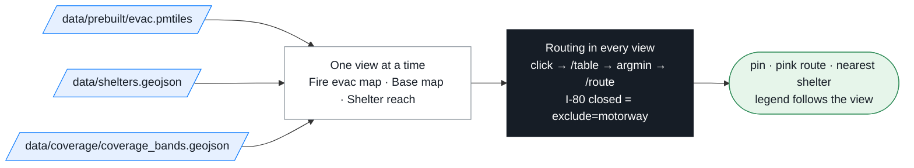

# Demo — the finished application (Phase 3d)

Static page, no build step: MapLibre GL JS 6.14.0 + PMTiles 4.5.0 from unpkg, `app.js` as one ES module.

> Teaching example, not an official evacuation resource. Drive-time estimates assume no traffic and no closures. In an emergency follow county OES / Genasys-Zonehaven alerts and CAL FIRE incident pages.



## Three views (strictly one at a time)

| View | Layers drawn | Legend |
|---|---|---|
| **Fire evac map** (default) | hazard (FHSZ), land cover, water, roads, buildings, past fire perimeters, town labels | Moderate / High / Very High · perimeter |
| **Base map** | OpenStreetMap raster (internet) | — |
| **Shelter reach** | water, roads, labels, drive-time bands | ≤ 10 min green · ≤ 20 blue · ≤ 30 light red |

Shelters, the pin and the route are on top in every view. Switching only flips `visibility` (`VIEWS` in `app.js`) — nothing is overlaid.
In the reach view, click a shelter to see only its bands; click the map to show all.

## Run

```bash
docker compose up -d           # Caddy serves the repo on :8080 and proxies /osrm → http://localhost:8080/demo/
npx serve -l 8080 .            # alternative, from the repo root (no routing)  — never python -m http.server (no Range support)
```

## Routing endpoint

First that answers `GET {base}/nearest/v1/driving/-121.08,38.90` with `"code":"Ok"` wins: same-origin `/osrm` (Caddy) → `http://localhost:5000` → `https://router.project-osrm.org` (https / GitHub Pages only; no `exclude=motorway`). `?osrm=https://host` overrides. Routing never blocks the map.

Per click: one `/table` (pin + 10 shelters, `sources=0&annotations=duration,distance`) → smallest duration → one `/route`. Points outside the study bbox are rejected before calling OSRM. **I-80 closed** re-solves with `exclude=motorway` and shows before/after.

## URL state

`?lng=-120.82&lat=39.02&closed=1&view=reach&shelter=placer-high`

## Data

Reads `data/…` first; if a GeoJSON is missing it uses `dev-fixtures/…` and shows a *fixture data* badge. Fonts: `../02-web/fonts/`.
Console hook: `rts.setView('reach')`, `rts.setStart(lng, lat)`, `rts.showShelterReach(id)`.
