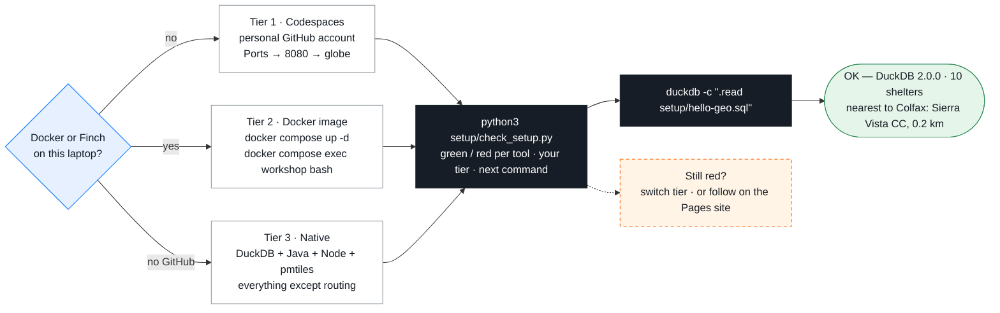

# Setup — Phase 0: pick one way to run

> Part of **Phase 0** in the [main README](../README.md#phase-0--setup--pick-one-way-to-run), which has the short version of each option. This page adds the install commands per OS, what each tier can and cannot do, and the PowerShell equivalents. `check_setup.py` calls the options tiers 1–3.



| Tier | For | Routing | Survives wifi loss |
|---|---|---|---|
| 1 Codespaces | no Docker, corporate laptop | yes | no |
| 2 Local containers — **recommended if you can run containers** | wants offline, nothing to install | yes | yes |
| 3 Native, no containers | containers blocked | **no** (pair with a neighbour; or `docker compose up -d osrm caddy` if you do have Docker) | yes |
| 4 Browser only (GitHub Pages) | laptop failed | no | no |

Clone shallow: `git clone --depth 1 https://github.com/vishal4c/routes-to-safety-workshop.git`. **Windows: use Git Bash** (PowerShell equivalents at the bottom).
Pinned versions (`versions.env`): DuckDB CLI 2.0.0 · Temurin 21 · Node 22 · go-pmtiles v1.31.2 · Planetiler v0.10.2 · OSRM `ghcr.io/project-osrm/osrm-backend:v26.10.0-debian` · maplibre-gl 6.14.0 · pmtiles JS 4.5.0.

---

## Tier 1 — Codespaces (nothing to install)

1. Use a **personal** GitHub account (employer‑managed accounts often block Codespaces).
2. Repo page → **Code → Codespaces → Create codespace on main**. The first start takes 2–3 minutes: GitHub pulls the same three containers as Tier 2, downloads the data bundle and runs `check_setup.py` for you — you type nothing until the terminal prompt appears.
3. Open the map from the **Ports tab → hover the row for port 8080 ("Workshop (Caddy)") → click the globe icon**. Never type `localhost:8080` into your own browser, and **never forward port 5000** (OSRM is only reached through Caddy at `/osrm/`).
4. The terminal is a Linux bash **inside the tool container**: every workshop command works as written, `$WEB_URL` and `$OSRM_URL` are preset. The one thing it cannot do is run Docker, so `scripts/build-osrm.sh` (Phase 2b, optional) only prints what it would do — the graph is already running.

## Tier 2 — Local containers

### Install a container runtime (pick one)

| Runtime | Notes | Install |
|---|---|---|
| **Finch** ← *recommended on corporate laptops* (Apache‑2.0, no Docker Desktop licence) | macOS, Windows (WSL2) | macOS: `brew install --cask finch` · Windows: `winget install Amazon.Finch` · then **`finch vm init`** (once) |
| Docker Desktop | free for personal/small business | macOS: `brew install --cask docker` · Windows: `winget install Docker.DockerDesktop` · Linux: `sudo apt install docker.io docker-compose-v2` |
| OrbStack | macOS only, light | `brew install --cask orbstack` |
| Colima | macOS/Linux, CLI only | `brew install colima docker docker-compose && colima start` |

Podman / nerdctl also work. The scripts and `check_setup.py` auto‑detect `docker → finch → podman → nerdctl`; override with `CONTAINER_CLI=finch`.

### Pull images and data (~1 GB, once)

```bash
git clone --depth 1 https://github.com/vishal4c/routes-to-safety-workshop.git
cd routes-to-safety-workshop
bash scripts/get-bundle.sh            # OSRM graph, prebuilt evac.pmtiles, planetiler.jar (checksum‑verified)
docker compose pull                   # Finch:  finch compose pull      Podman: podman compose pull
```

`docker compose pull` fetches three images: the **tool image** `ghcr.io/vishal4c/routes-to-safety-workshop:latest` (DuckDB + spatial, Temurin 21,
Planetiler, go-pmtiles, Node 22, osmium, uv — the same image Codespaces uses, amd64 + arm64), OSRM and Caddy. With it you install **nothing else**.

Finch first time only: `finch vm init` (a few minutes), later `finch vm start`.

### Run

```bash
docker compose up -d                  # Finch: finch compose up -d
# map + files:  http://localhost:8080/        routing:  http://localhost:8080/osrm/nearest/v1/driving/-121.08,38.90
docker compose down                   # when finished
```

### Work inside the tool container (recommended — nothing else to install)

```bash
docker compose exec workshop bash     # Finch: finch compose exec workshop bash
python3 setup/check_setup.py          # expect: tier 2, OSRM reachable via http://caddy:8080/osrm, web server OK
duckdb -c ".read setup/hello-geo.sql"
```

- The repo is bind-mounted at `/workspaces/routes-to-safety-workshop` (the working directory): every command in the module READMEs runs unchanged; what you write to `out/` is served at <http://localhost:8080/> on your laptop.
- `curl` inside the container: `$OSRM_URL` (= `http://caddy:8080/osrm`). The browser uses `/osrm` on :8080 automatically.
- No Docker inside the tool container → `scripts/build-osrm.sh` (Phase 2b optional / your own town) runs in a **laptop terminal** in the clone folder, not in this shell.
- Prefer native tools? Install as in Tier 3; `osrm` + `caddy` from `docker compose up -d` are all you need from Docker.

## Tier 3 — Native, no containers (no routing)

### macOS (Homebrew)
```bash
brew install duckdb                    # check: duckdb --version → v2.0.0
brew install --cask temurin@21
brew install node@22                   # or: brew install node
brew install uv
brew install pmtiles                   # go-pmtiles. NOT `pip/conda install pmtiles`
```
### Windows (winget, then use **Git Bash**)
```powershell
winget install Git.Git
winget install DuckDB.cli
winget install EclipseAdoptium.Temurin.21.JDK
winget install OpenJS.NodeJS.LTS
winget install astral-sh.uv
# go-pmtiles: download go-pmtiles_1.31.2_Windows_x86_64.zip from
#   https://github.com/protomaps/go-pmtiles/releases/tag/v1.31.2
# unzip pmtiles.exe into a folder on PATH, e.g. %USERPROFILE%\bin
```
Close and reopen Git Bash after installing so PATH refreshes. If `duckdb` is older than 2.0.0, download `duckdb-cli-windows-amd64.tar.gz` from the DuckDB v2.0.0 release page instead.
### Linux (Debian/Ubuntu, apt)
```bash
sudo apt update && sudo apt install -y curl unzip git python3 osmium-tool
# Temurin 21
sudo mkdir -p /etc/apt/keyrings && curl -fsSL https://packages.adoptium.net/artifactory/api/gpg/key/public | sudo tee /etc/apt/keyrings/adoptium.asc >/dev/null
echo "deb [signed-by=/etc/apt/keyrings/adoptium.asc] https://packages.adoptium.net/artifactory/deb $(. /etc/os-release; echo $VERSION_CODENAME) main" | sudo tee /etc/apt/sources.list.d/adoptium.list
sudo apt update && sudo apt install -y temurin-21-jdk
# Node 22
curl -fsSL https://deb.nodesource.com/setup_22.x | sudo -E bash - && sudo apt install -y nodejs
# DuckDB 2.0.0 (amd64; use arm64 on ARM)
curl -fsSL https://github.com/duckdb/duckdb/releases/download/v2.0.0/duckdb-cli-linux-amd64.tar.gz | sudo tar -xz -C /usr/local/bin duckdb
# go-pmtiles v1.31.2 (x86_64; use arm64 on ARM)
curl -fsSL https://github.com/protomaps/go-pmtiles/releases/download/v1.31.2/go-pmtiles_1.31.2_Linux_x86_64.tar.gz | sudo tar -xz -C /usr/local/bin pmtiles
# uv
curl -LsSf https://astral.sh/uv/install.sh | sh
```
### Data and serving
```bash
bash scripts/get-bundle.sh             # PowerShell: powershell -ExecutionPolicy Bypass -File scripts\get-bundle.ps1
npx serve -l 8080 .                    # static server with Range support. Never `python -m http.server`.
```
Offline / USB: `BUNDLE_ZIP=/path/to/data-bundle.zip bash scripts/get-bundle.sh`.

**Alternative:** `pixi install && pixi shell` (see `pixi.toml`) gives DuckDB, Java 21, Node, osmium, uv. It deliberately has **no pmtiles** — the conda‑forge package of that name is a Python library. Always install the go‑pmtiles binary as above.

## Tier 4 — Browser only

Open https://vishal4c.github.io/routes-to-safety-workshop/ — slides, the demo map and the 02‑web map with shelters. No routing, nothing to install.

---

## Check your setup

```bash
python3 setup/check_setup.py          # Windows Git Bash: python setup/check_setup.py
duckdb -c ".read setup/hello-geo.sql"
```
You should see:
`OK — DuckDB 2.0.0 · 10 shelters (1 verified, 9 candidate) · nearest to Colfax (crow-flies): Sierra Vista Community Center, 0.2 km`

`check_setup.py` shows green/red per tool, which tier it thinks you are on, and the exact next command. "No routing on this tier" is normal for tiers 3 and 4.

## Git Bash → PowerShell equivalents

Use Git Bash if you can. If you must use PowerShell:

| Git Bash | PowerShell |
|---|---|
| `bash scripts/get-bundle.sh` | `powershell -ExecutionPolicy Bypass -File scripts\get-bundle.ps1` |
| `bash 01-tiles/build.sh` | `powershell -ExecutionPolicy Bypass -File 01-tiles\build.ps1` |
| `python3 setup/check_setup.py` | `python setup\check_setup.py` |
| `duckdb -c ".read 00-data/01-explore.sql"` | same (use `/` or `\`) |
| `ls out/` | `Get-ChildItem out\` (alias `ls` works) |
| `cat file` | `Get-Content file` (alias `cat` works) |
| `mkdir -p out` | `New-Item -ItemType Directory -Force out` |
| `rm -rf out/*` | `Remove-Item out\* -Recurse -Force` |
| `cp a b` / `mv a b` | `Copy-Item a b` / `Move-Item a b` |
| `ls -lh out/evac.pmtiles` | `Get-Item out\evac.pmtiles \| Select Name,Length` |
| `export VAR=value` | `$env:VAR = "value"` |
| `VAR=value cmd` | `$env:VAR="value"; cmd` |
| `curl -s URL` | `curl.exe -s URL` (plain `curl` is an alias for Invoke‑WebRequest) |
| `curl -s URL \| head -c 200` | `(curl.exe -s URL).Substring(0,200)` |
| `java -Xmx2g -jar 01-tiles/planetiler.jar …` | same (line continuation is a backtick `` ` ``, not `\`) |
| `pmtiles show out/evac.pmtiles` | same |
| `npx serve -l 8080 .` | same |
| `docker compose up -d` / `finch compose up -d` | same |
| `which duckdb` | `Get-Command duckdb` |
| `open http://localhost:8080` | `start http://localhost:8080` |
| `grep -n foo file` | `Select-String -Path file -Pattern foo` |
| `sha256sum file` | `Get-FileHash file -Algorithm SHA256` |

If a command isn't in this table and fails in PowerShell, it works in Git Bash — switch.
